

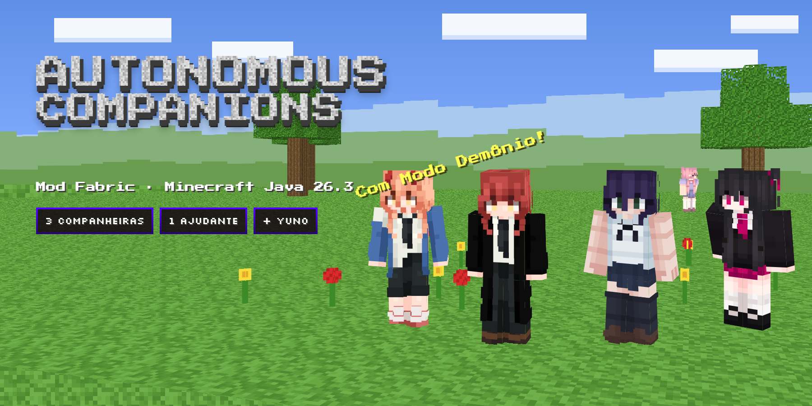

<a href="https://github.com/Yuyusukii/autonomous-companions/releases/latest">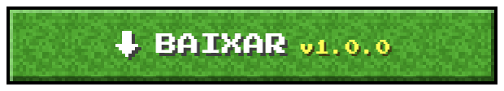</a>

<a href="#-as-companheiras"><b>Companheiras</b></a> ·
<a href="#%EF%B8%8F-o-que-elas-fazem"><b>O que fazem</b></a> ·
<a href="#-por-dentro-do-jogo"><b>Telas</b></a> ·
<a href="#-modo-dem%C3%B4nio"><b>Modo Demônio</b></a> ·
<a href="#-yuno"><b>Yuno</b></a> ·
<a href="#-instala%C3%A7%C3%A3o"><b>Instalação</b></a>

---

**Autonomous Companions** é um mod **Fabric** para **Minecraft Java Edition 26.3** que coloca no seu mundo três companheiras que **pensam e agem sozinhas**. Você dá um nome a cada uma, e elas te acompanham, exploram, mineram, cortam árvores, fabricam ferramentas, caçam, lutam e constroem casas **usando as mesmas regras do jogador**: receitas reais, ferramenta certa para cada bloco, nada de item surgindo do nada.

Tudo roda dentro do próprio jogo, sem nenhum serviço externo de IA. Funciona no singleplayer e em servidores.

## 💎 As companheiras

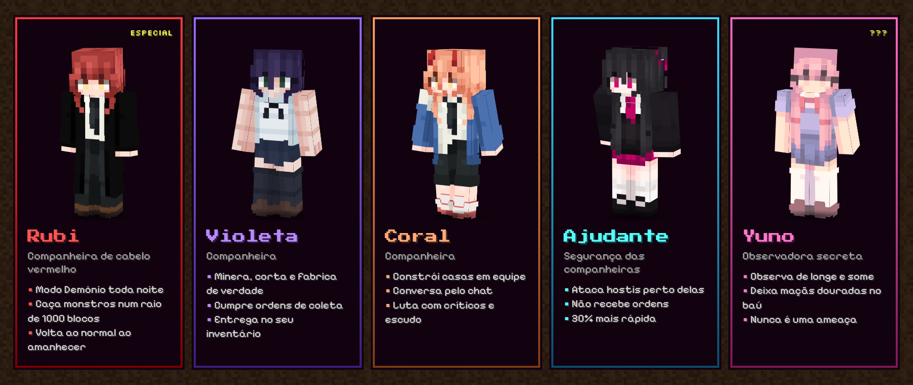

| | Quem é | O que tem de especial |
| :---: | --- | --- |
| 🔴 | **Rubi** (cabelo vermelho) | Desperta o **Modo Demônio** toda noite e caça os monstros ao redor até amanhecer |
| 🟣 | **Violeta** | Companheira completa: coleta, fabrica, constrói, luta e conversa |
| 🟠 | **Coral** | Companheira completa, ótima para dividir obras em equipe |
| 🔵 | **Ajudante** | Faz a **segurança** das três: ataca qualquer monstro que chegue perto delas |
| 🌸 | **Yuno** | Não segue nem fala com você... só observa de longe e deixa **presentes** no seu baú |

> Ao entrar no mundo pela primeira vez, elas aparecem perto de você num lugar seguro. **Clique com o botão direito** em uma delas para dar um nome: a partir daí, o painel de comandos é seu.

## ⚒️ O que elas fazem

| | |
| --- | --- |
| ⛏️ **Coleta e mineração de verdade** | Peça qualquer bloco do jogo (até de outros mods), na quantidade exata. Ela decide se vai minerar, fabricar, fundir ou caçar, e monta a cadeia inteira: tábuas → bancada → picareta de madeira → pedra → ferro → diamante. |
| 🪓 **Ferramenta certa antes de começar** | Sem machado para cortar 16 troncos? Ela corta o necessário à mão, faz tábuas, gravetos, bancada e machado, e só então segue com o trabalho. |
| 🏠 **Casas inteiras, bloco por bloco** | 6 estilos (Chalé de madeira, Medieval, Oriental, Rústica, Moderna, Campo com varanda) em 3 tamanhos. Ela junta os materiais, prepara o terreno, constrói em fases e confere o resultado. Dá para construir **em equipe**, com as três dividindo a lista de materiais. |
| 🌳 **Limpar terreno** | Escolha uma área de 8×8 até 32×32 e ela tira mato, pedras e **árvores inteiras** (sem tronco flutuando), tapa buracos com terra e deixa tudo plano. |
| 💬 **Conversa pelo chat** | Escreva o nome dela e o pedido: `Luna, traga 10 barras de ferro`, `faça uma fornalha`, `onde tem diamante?`, `o que você está vendo?`. Ela entende e responde no chat. |
| ⚔️ **Combate de jogador** | Críticos pulando, golpe em corrida, varredura de espada, escudo, arco contra creeper. Protege você e as outras. |
| 🍖 **Comida e sobrevivência** | Caça o animal mais próximo, cozinha a carne e foge de lava, afogamento e creepers. Por padrão elas têm vida infinita e não sentem fome nem cansaço (tudo configurável). |
| 🧠 **Memória** | Lembram da sua base, dos recursos que já viram e do que aprenderam com cada tentativa. Tudo fica salvo no mundo. |
| 👷 **Funções** | Mineradora, Lenhadora, Construtora, Exploradora, Guarda, Coletora ou Agricultora: com uma função definida, ela trabalha sozinha quando não tem ordens. |
| 📯 **Apito das Companheiras** | Você já começa com ele. Botão direito chama uma delas ou as três, de qualquer lugar do mundo, até de outra dimensão. |

## 🖼️ Por dentro do jogo

<table>
<tr>
<td width="50%">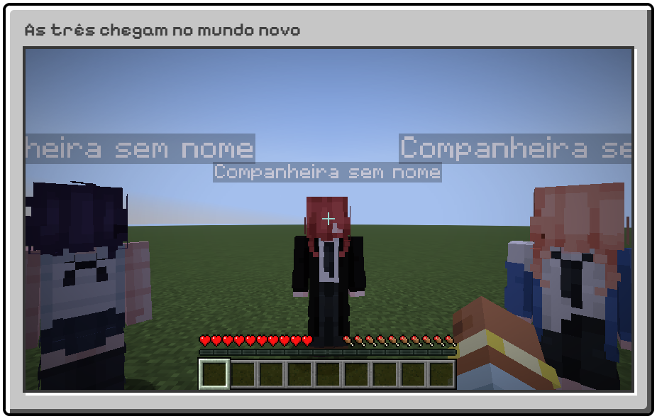</td>
<td width="50%">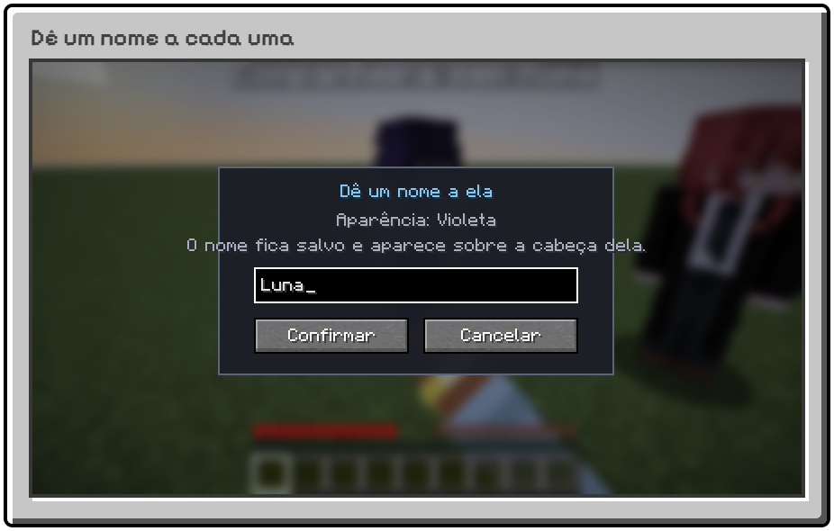</td>
</tr>
<tr>
<td width="50%">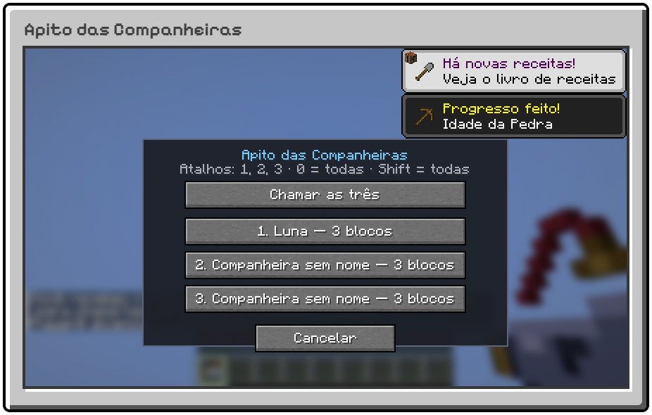</td>
<td width="50%">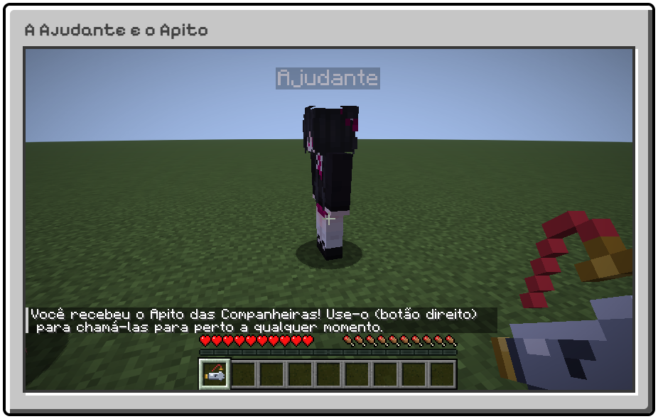</td>
</tr>
</table>

### 📋 O painel de comandos

Clique com o botão direito numa companheira e o painel abre com **8 abas**: Coleta, Obras, Combate, Comida, Função, Itens, Estado e Config.

<table>
<tr>
<td width="50%">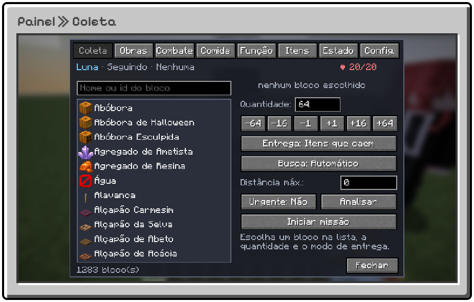</td>
<td width="50%">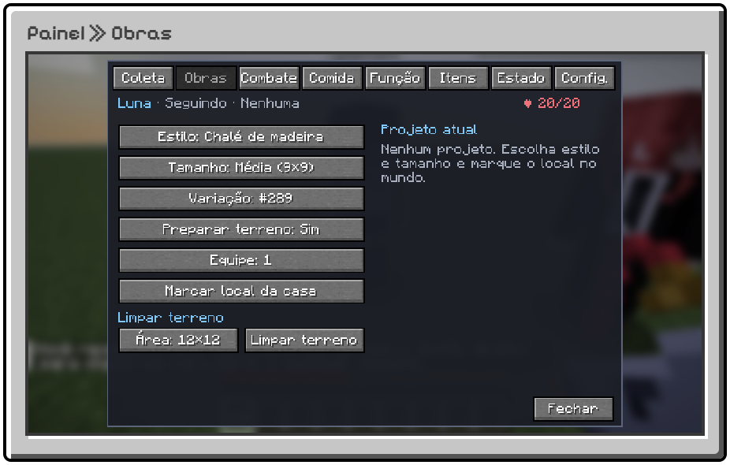</td>
</tr>
<tr>
<td width="50%">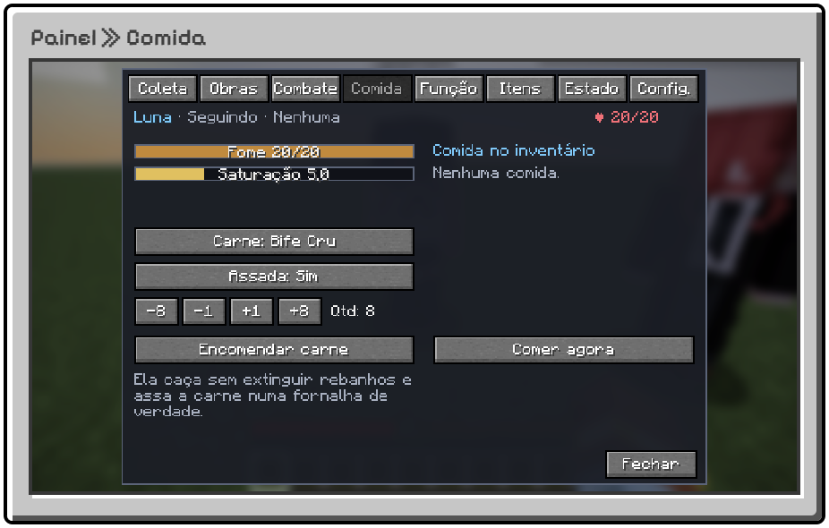</td>
<td width="50%">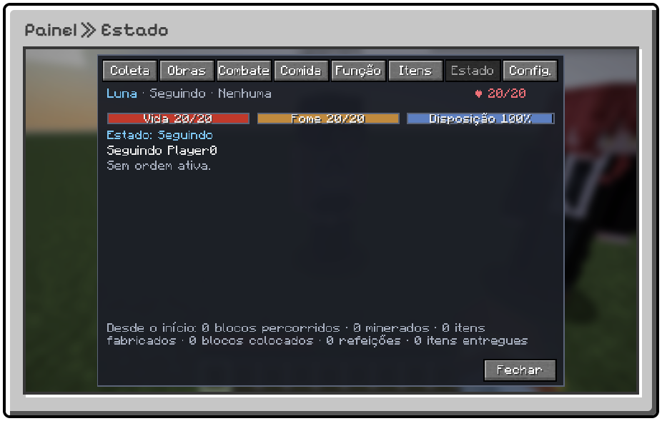</td>
</tr>
<tr>
<td width="50%">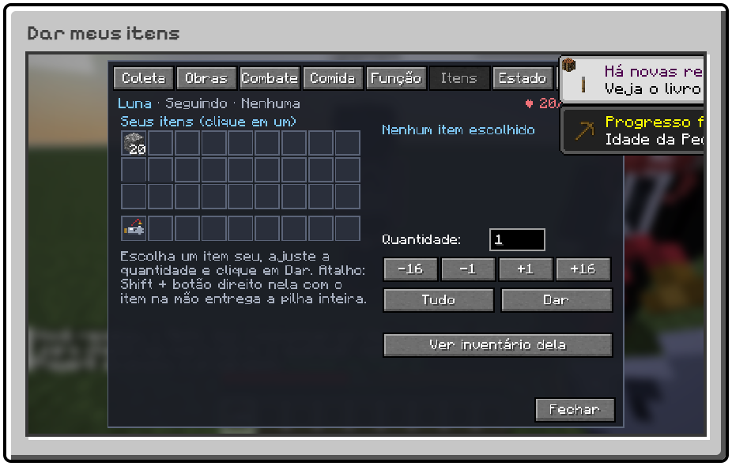</td>
<td width="50%">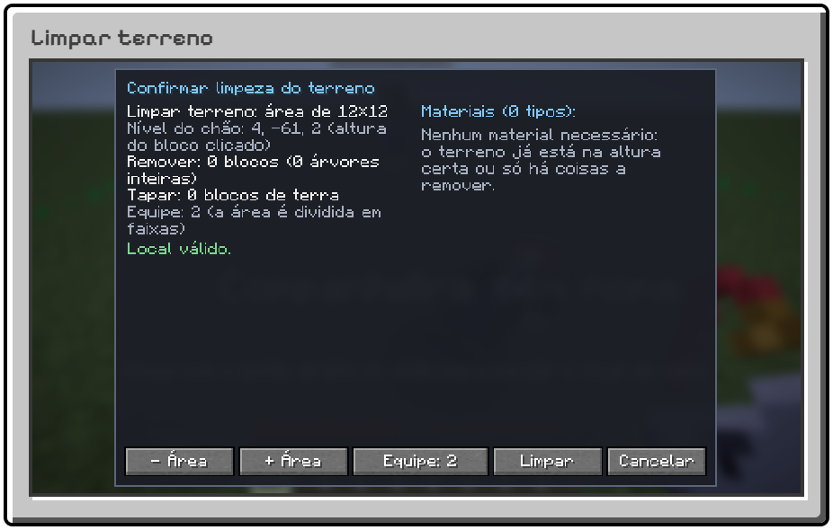</td>
</tr>
</table>

<b>O que cada aba faz</b>

 

| Aba | Para que serve |
| --- | --- |
| **Coleta** | Catálogo com todos os blocos do jogo, busca por nome, quantidade exata (1 a 2304), modo de entrega e distância máxima |
| **Obras** | Estilo, tamanho e variação da casa, preparar terreno, equipe (1 a 3), marcar o local e limpar terreno |
| **Combate** | Proteger você, defesa proativa, equipar sozinha e fabricar armas e armadura conforme o perigo |
| **Comida** | Fome e saturação, encomendar carne (crua ou assada) e comer agora |
| **Função** | Mineradora, Lenhadora, Construtora, Exploradora, Guarda, Coletora, Agricultora |
| **Itens** | Inventário de 36 espaços, equipamento, entregas e **Dar meus itens** |
| **Estado** | Vida, fome, o que está fazendo agora e a fila de ordens (cancelar, suspender, retomar, urgente) |
| **Config.** | Distâncias, explorar quando ociosa, Seguir-me, Ficar aqui, Voltar até mim, Descansar, Renomear |

## 😈 Modo Demônio

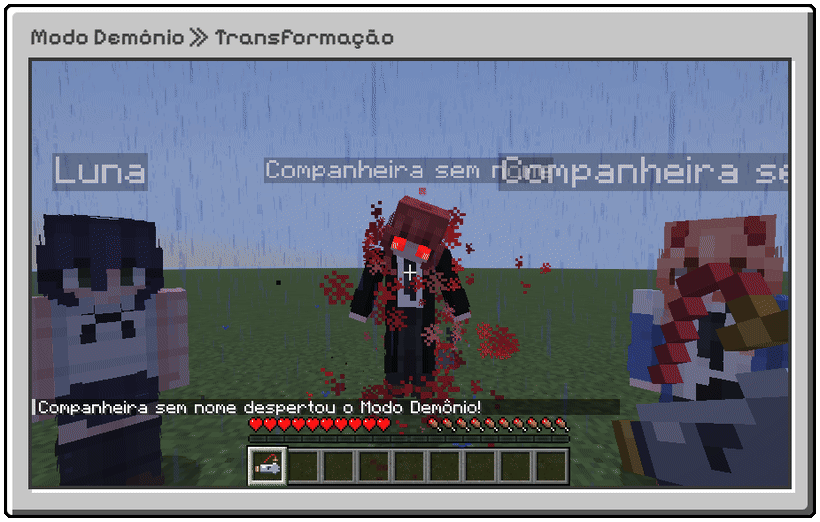

Só a **Rubi**, a companheira de cabelo vermelho, tem esse poder. **Toda noite** ela para, inclina a cabeça, o cabelo começa a pulsar, os olhos brilham em vermelho e uma aura carmesim cresce até explodir. O céu escurece, cai uma tempestade e ela começa a flutuar.

Daí até o amanhecer, ela **caça os monstros hostis num raio de até 1000 blocos**, teletransportando de um em um. Animais, aldeões, jogadores e as outras companheiras nunca são alvo. Quando o sol nasce, ela desce, volta para perto de você e você recebe uma mensagem com quantos monstros ela eliminou.

## 🌸 Yuno

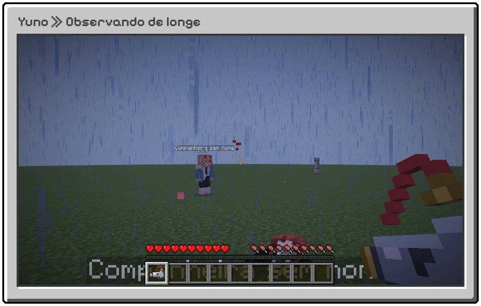

A Yuno chega junto com as outras, mas é **completamente diferente**: não conversa, não segue e não luta. Ela é apaixonada por você e **não quer ser vista**.

- Fica sempre **escondida, de longe**, atrás de árvores e paredes, mas com você no campo de visão.
- Se você olhar para ela, há um breve **vislumbre** e ela **some** numa nuvem de pétalas de cerejeira.
- **Uma vez por dia de jogo**, quando você está longe de um baú seu, ela vai até lá, abre a tampa e deixa uma **maçã dourada**. Na próxima vez que você abrir o baú: *"Alguém deixou um presente para você... ♥"*

## 📦 Instalação

| Precisa de | Versão |
| --- | --- |
| Minecraft Java Edition | **26.3** |
| [Fabric Loader](https://fabricmc.net/use/installer/) | **0.19.5** ou mais novo |
| [Fabric API](https://modrinth.com/mod/fabric-api) | **0.163.0+26.3** |
| Java | **25** (o launcher oficial já traz) |

1. Instale o **Fabric Loader** para o Minecraft 26.3 pelo [instalador oficial](https://fabricmc.net/use/installer/).
2. Baixe a **Fabric API** 0.163.0+26.3 no [Modrinth](https://modrinth.com/mod/fabric-api).
3. Baixe o **[autonomous-companions-1.0.0.jar](https://github.com/Yuyusukii/autonomous-companions/releases/latest/download/autonomous-companions-1.0.0.jar)**.
4. Coloque os dois arquivos na pasta `mods`:
   - Windows: `%APPDATA%\.minecraft\mods`
   - Linux: `~/.minecraft/mods`
   - macOS: `~/Library/Application Support/minecraft/mods`
5. Abra o launcher, escolha o perfil **fabric-loader-26.3** e crie um mundo novo.

> Em servidor, coloque os mesmos dois arquivos na pasta `mods` do servidor **e** do jogador. A configuração é criada em `config/autonomouscompanions.json` na primeira vez que o jogo abre.

## ⌨️ Comandos

Use `/companheiras` (ou `/companions`):

<b>Ver todos os comandos</b>

 

| Comando | O que faz |
| --- | --- |
| `lista` | Suas companheiras (vivas e mortas) |
| `apito` | Recebe um novo Apito das Companheiras |
| `estado <nome>` | Vida, fome, posição, função e o que está fazendo |
| `missao <nome>` | Ordens em andamento com o progresso |
| `inventario <nome>` | Inventário dela, com os itens reservados |
| `ordem <nome> <bloco> <quantidade>` | Ordem de coleta pelo chat |
| `cancelar <nome>` · `recuperar <nome>` | Cancela as ordens / traz para perto com segurança |
| `percepcao <nome>` · `memoria <nome>` | O que ela vê agora / o que ela lembra |
| `base` | Marca sua posição como base para todas |
| `saber <pergunta>` | Pergunta sobre itens, receitas e minérios |
| `habilidades` · `habilidade <nome> <id>` | Lista e pede habilidades |
| `catalogo ver <texto>` | Como obter um item ou bloco desta versão |
| `config ver/recarregar/definir` | Configuração (operador) |
| `versao` | Versão do mod |

<b>Configuração</b>

 

Arquivo `config/autonomouscompanions.json`, ou em jogo com `/companheiras config definir <chave> <valor>`.

| Chave | Padrão | O que muda |
| --- | --- | --- |
| `vidaInfinita` · `semFome` · `semCansaco` | `true` | Regras de sobrevivência das companheiras |
| `modoDemonioTodaNoite` · `raioModoDemonioNoturno` | `true` · `1000` | Modo Demônio e o raio da caçada |
| `ajudanteSeguranca` · `raioSegurancaAjudante` | `true` · `16` | Ajudante como segurança e o alcance dela |
| `limiteExploracaoOciosa` | `100` | Distância máxima de você quando estão sem ordens |
| `distanciaMinimaAcompanhamento` · `distanciaMaximaAcompanhamento` | `3` · `7` | Distância ao te seguir |
| `construcaoHabilitada` · `permitirPrepararTerreno` | `true` | Construção de casas |
| `modoCompanheirasIniciais` | `PRIMEIRO_JOGADOR` | Quem recebe companheiras: primeiro jogador, cada jogador ou ninguém |

A lista completa está no [manual](docs/MANUAL.md#6-configuração).

<b>Para desenvolvedores</b>

 

Requer **JDK 25**; o Gradle vem pelo wrapper.

| Tarefa | Comando |
| --- | --- |
| Abrir o jogo com o mod | `./gradlew runClient` |
| Servidor de desenvolvimento | `./gradlew runServer` |
| Testes unitários | `./gradlew test` |
| Testes de jogo (GameTest) | `./gradlew runGameTest` |
| Compilar o `.jar` | `./gradlew build` |

O comportamento das companheiras é verificado por **119 testes automáticos de jogo** num servidor real (coleta, fabricação, combate, obras, Modo Demônio, Yuno, memória e conversa) e por um teste de cliente que abre o jogo e passa por todas as telas.

O [manual completo](docs/MANUAL.md) traz todos os detalhes de comportamento, prioridades da IA e configurações.

---

Feito por <a href="https://github.com/Yuyusukii">Yukki</a> · licença MIT · não é um produto oficial do Minecraft e não é aprovado nem associado à Mojang ou à Microsoft.

