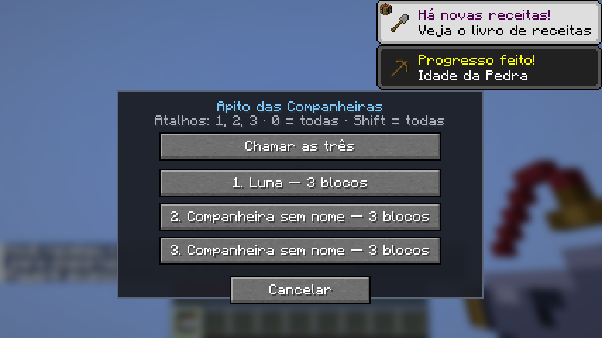
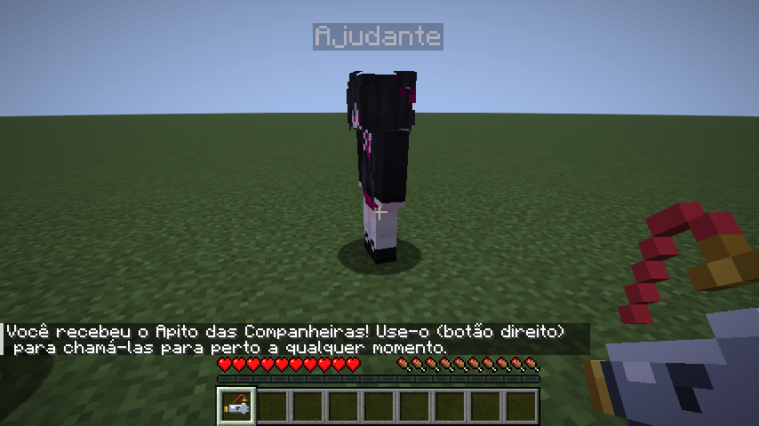
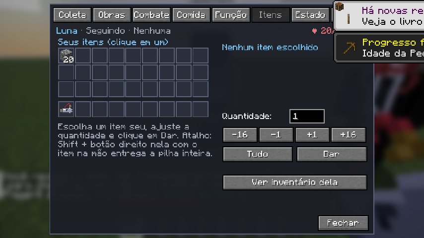
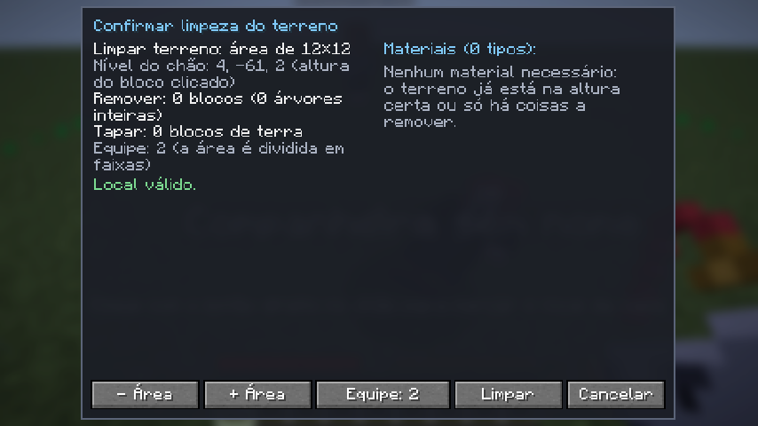
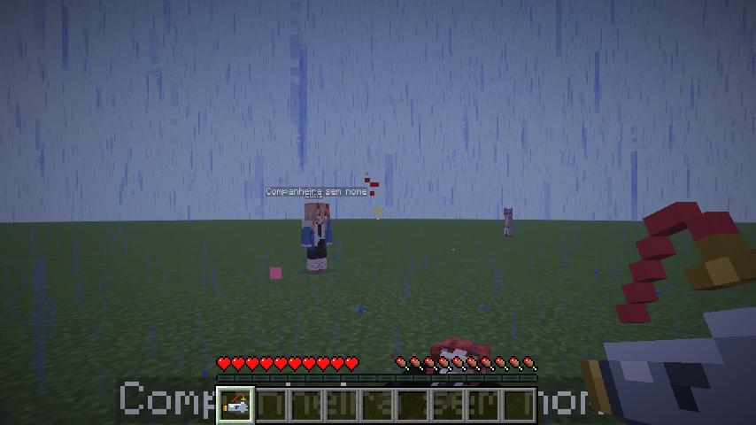
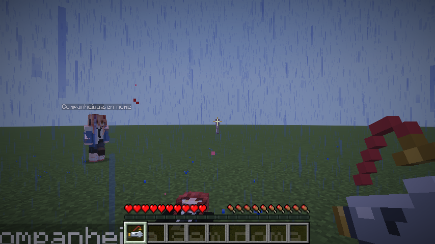
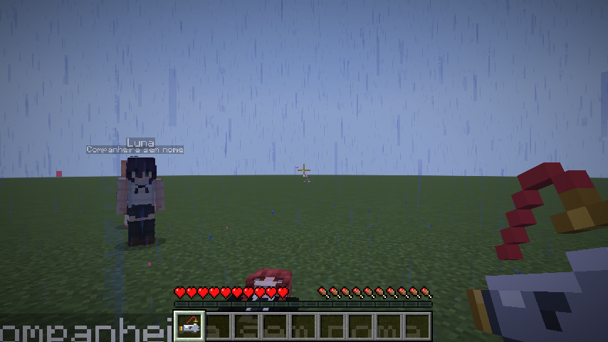
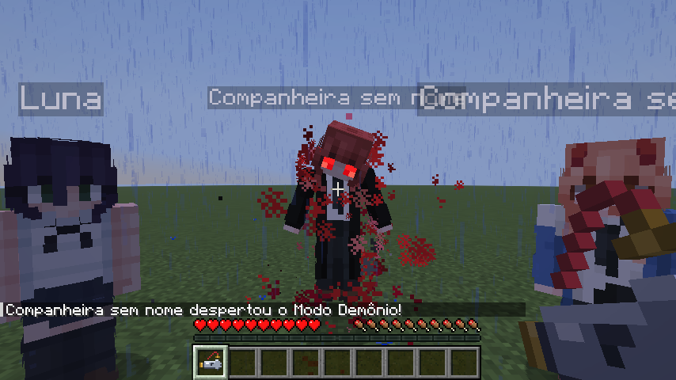
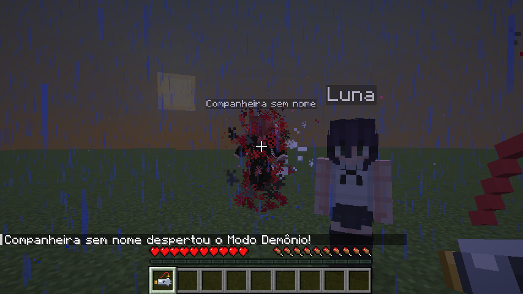
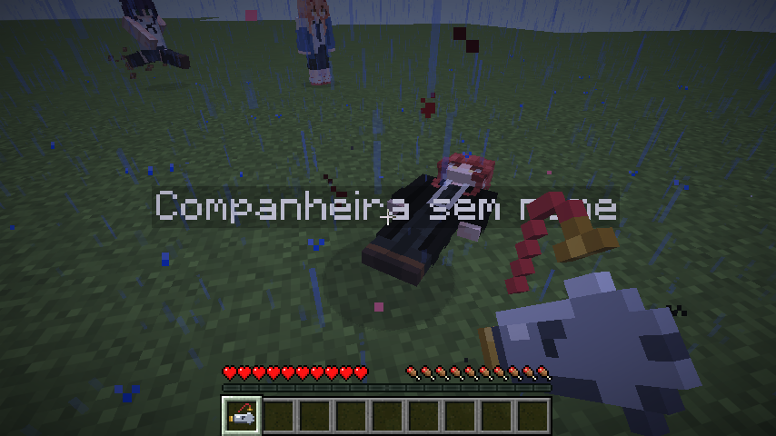

# Autonomous Companions (Três Companheiras Autônomas)

Mod **Fabric** para **Minecraft Java Edition 26.3** que adiciona três companheiras humanoides autônomas e uma ajudante que faz a segurança delas (mais a Yuno, que só observa de longe e deixa presentes). Elas recebem
nome, acompanham você, exploram com moderação, cumprem ordens de coleta, fabricação e construção de verdade e cooperam
entre si. Por padrão têm **vida infinita, não sentem fome nem cansaço**; a de cabelo vermelho entra no **Modo Demônio
toda noite** (tudo configurável). Têm um **cérebro híbrido** — percepção do jogo real, memória persistente, catálogo
gerado da versão carregada, habilidades executáveis, conhecimento prático e conversa pelo chat (seção "Cérebro
híbrido"). Tudo roda no servidor, sem serviços externos de IA.

- ID do mod: `autonomouscompanions`
- Versão: 1.0.0
- Licença: MIT

---

## 1. Dependências obrigatórias

| Componente | Versão | Onde instalar |
|---|---|---|
| Minecraft Java Edition | **26.3** | — |
| Java | **25** (o launcher oficial já traz) | — |
| Fabric Loader | **0.19.5** ou mais novo | instalador do Fabric |
| Fabric API | **0.163.0+26.3** | pasta `mods` |
| Autonomous Companions | `autonomous-companions-1.0.0.jar` | pasta `mods` |

Não há outras dependências. O mod precisa estar instalado **no servidor e no cliente** (as telas são do cliente; toda
a lógica é do servidor).

## 2. Instalação (jogadores)

1. Instale o Fabric Loader 0.19.5+ para o Minecraft 26.3 (https://fabricmc.net/use/installer/).
2. Baixe a Fabric API 0.163.0+26.3 (Modrinth ou CurseForge).
3. Copie os dois arquivos para a pasta `mods` do jogo:
   - Windows: `%APPDATA%\.minecraft\mods\`
   - Linux: `~/.minecraft/mods/`
   - macOS: `~/Library/Application Support/minecraft/mods/`
   - `fabric-api-0.163.0+26.3.jar` → `mods/`
   - `autonomous-companions-1.0.0.jar` → `mods/`
4. Abra o launcher, escolha o perfil **fabric-loader-26.3** e jogue.

Em servidor dedicado, coloque os mesmos dois arquivos na pasta `mods/` do servidor. O arquivo de configuração é criado
em `config/autonomouscompanions.json` na primeira execução.

## 3. Como usar no jogo

### Primeiro contato
Ao entrar pela primeira vez num mundo, três companheiras aparecem perto de você em locais seguros (chão firme, sem
lava, água ou sufocamento). Elas são criadas **uma única vez** por mundo (registro persistente; não duplicam ao
reentrar, morrer, trocar de dimensão ou recarregar chunks), cada uma com UUID próprio e vinculada a você.

Sem nome, elas apenas esperam. **Clique com o botão direito** numa delas: abre a tela de nome (campo, Confirmar,
Cancelar). O nome é salvo permanentemente, aparece sobre a cabeça dela e o **painel de comandos abre logo em seguida**.
Clique com o botão direito novamente a qualquer momento para abrir o painel. Só a dona pode nomear, dar ordens ou ver o
inventário (o servidor valida cada pacote).

### Apito das Companheiras
Você já nasce com o **Apito das Companheiras** (entregue uma única vez por jogadora ao entrar no mundo; em mundos
criados antes desta versão, entregue na próxima entrada). **Botão direito com o apito** chama todas as suas
companheiras. Abre um **menu** para chamar **uma delas** (botões 1, 2, 3 com nome, distância e, ao passar o
mouse, vida e estado) ou **as três de uma vez** (botão "Chamar as três", tecla 0 ou T). **Shift + botão direito** chama
as três direto, sem menu. Quem é chamada **suspende o que estava fazendo** (a ordem em andamento e as da fila ficam suspensas — com o
progresso e os itens já obtidos ainda reservados para elas — e podem ser retomadas na aba Estado), saem do modo "ficar aqui",
acordam se estiverem dormindo e **correm** até você. Se estiverem em outra dimensão, a mais de 64 blocos, sem rota ou
sem progresso, são trazidas para um lugar seguro ao seu lado. Perdeu o apito? Fabrique outro (barbante em cima,
pepita–lingote–pepita de ferro embaixo) ou use `/companheiras apito`.
Ao chegar, **ela fica com você por 3 minutos**: não sai explorando, não volta ao trabalho da função e não sai para caçar
comida (só se a fome for crítica). Qualquer ordem nova encerra essa espera na hora.
A ajudante não atende ao apito (ela continua fazendo a segurança das outras).



### A ajudante
Junto com as três nasce uma quarta NPC, a **Ajudante** (a skin enviada por último, com braços largos). **Você não
controla a ajudante**: ela não tem painel, não recebe ordens nem nome (clicar nela só mostra o que está fazendo; Shift +
botão direito com um item entrega o item a ela).

**Segurança das outras (padrão desde 18/10/2026):** é só isso que ela faz. Ataca todo monstro hostil que estiver a até
16 blocos de uma companheira sua (ou que esteja mirando uma delas), mesmo que ele ainda não tenha atacado ninguém,
olhando companheiras a até 128 blocos; sem perigo, fica de posto junto da companheira mais próxima. Usa o combate
completo das outras (melhor arma que tiver, críticos, escudo, arco contra creepers) — sem arma, luta com as mãos.
Animais, aldeões, animais domesticados, jogadores e aliadas nunca são alvo. Como segurança, a guarda que a traz de volta
para perto de você também aceita que ela esteja junto de uma companheira longe. Opções: `ajudanteSeguranca` e
`raioSegurancaAjudante`.

**Abastecedora (regras antigas, com `ajudanteSeguranca` desligado):** ela serve as outras três o tempo todo, em ordem
de urgência:
1. **Comida urgente** — quem está com fome ou ferida e **sem comida** recebe carne o quanto antes; sem estoque, ela
   caça na hora (prefere os animais que estão por perto).
2. **Itens de pedra** — quem não tem **picareta, espada, machado ou pá de pedra (ou melhor)**, ou está com a ferramenta
   quase quebrando, recebe uma de pedra fabricada por ela (minera pedra e faz tábuas, gravetos e bancada sozinha).
3. **Reposição** — quem tem menos de 4 comidas recebe mais.
4. **Estoque** — sem pedidos, ela mantém cerca de 8 carnes guardadas.

**Ela fica perto de você:** só começa um serviço a até 40 blocos de você, só atende quem está a até 70 blocos de você, e
larga o serviço e volta se passar de 80 blocos. Enquanto trabalha, mantém o entorno dela ativo (antes, ao caçar longe,
ela saía da área que o jogo mantém ativa e simplesmente congelava lá — parecia que tinha sumido). Se mesmo assim ficar
a mais de 96 blocos de você, ou parada numa área inativa, ela é trazida para um lugar seguro ao seu lado.

Ela é **30% mais rápida** que as outras e corre nas entregas. Entrega direto no inventário da companheira (só sai
dela o que coube). Foge, se defende, come e dorme como as outras e acompanha você quando não há o que fazer. Morta, é
revivida como as outras. Em mundos criados antes desta versão, ela aparece perto de você na próxima entrada
(operadores também podem usar `/companheiras criar_ajudante`).



### Dar itens para elas
- Na aba **Itens**, clique em **Dar meus itens**: a grade passa a mostrar o **seu** inventário. Clique num item,
  ajuste a quantidade (campo, botões −16/−1/+1/+16 ou **Tudo**) e clique em **Dar**. Qualquer item, qualquer
  quantidade (até a pilha inteira daquele espaço, inclusive a mão secundária).
- Atalho: **Shift + botão direito** nela com um item na mão entrega a pilha inteira da mão (o apito não é entregue).
- O servidor valida tudo: só a dona, a até 8 blocos; só sai do seu inventário o que realmente coube no dela (nunca
  duplica nem some); se ela estiver cheia, aparece o aviso e nada é retirado.



### Conversar pelo chat
Escreva no chat o **nome** de uma companheira sua (ou **"todas"**) e o pedido ou a pergunta. Ela entende localmente (no
próprio mod, sem serviço de IA) e responde no chat; quem age é o código do mod, com as mesmas regras da tela (um pedido
recusado explica o motivo).

| Exemplo | O que acontece |
|---|---|
| `Makima, traga 10 barras de ferro` / `pegue meia pilha de tábuas` | Pedido de item (o planejador decide minerar, fabricar, caçar ou fundir) e entrega. |
| `Power, faça uma fornalha` / `fabrique 3 baús` | Pedido de fabricação. |
| `Raze, minere ferro` / `colete madeira` / `faça tochas` | Usa a **habilidade** correspondente (ver "Cérebro híbrido"). |
| `Makima, traga carne` / `busca carne assada` | Carne do animal mais perto (crua ou assada). |
| `o que você está fazendo?` | Atividade atual, pedido, vida, fome e cansaço. |
| `o que você vê?` / `olhe em volta` | **Percepção**: posição, bioma, hora, clima, ferramentas, inventário, blocos de interesse, criaturas, perigos, a dona e a base. |
| `o que você lembra?` | **Memória**: base, recursos vistos, hipóteses de área, o que aprendeu com as tentativas e as últimas experiências. |
| `onde tem diamante?` | O que ela lembra (posição exata ou área provável) e a faixa de altura em que o minério é gerado nesta versão. |
| `como faço uma picareta de pedra?` / `o que é obsidiana?` | **Conhecimento**: a parte relevante do guia, como obter (receita, ferramenta mínima) e a habilidade relacionada. |
| `aqui é a base` | Grava a sua posição como base (fato) na memória dela. |
| `pare` / `venha` / `descanse` | Cancela o pedido atual / vem até você (como o apito) / descansa. |
| `ajuda` | Lista o que ela sabe fazer pela conversa. |

Quantidades: número ou por extenso ("dez", "uma pilha" = 64, "meia pilha" = 32). Itens pelo nome no idioma do jogo ou
pelo id (`minecraft:iron_ingot`).

### Painel de comandos (8 abas)
| Aba | O que faz |
|---|---|
| **Coleta** (Coleta e mineração) | Catálogo com todos os blocos registrados (inclusive de outros mods), busca por nome traduzido, nome simples ou id (`minecraft:stone`), quantidade exata (1 a 2304, botões ±1/16/64), modo de entrega (**bloco exato** — com Toque Suave se ela tiver, ou por receita/fundição — ou **itens que caem**), perfil de busca, distância máxima, urgência, botão Analisar (mostra método, ferramentas, alcance) e Iniciar missão. |
| **Obras** (Construção) | Estilo (6), tamanho (3), variação procedural, preparar terreno, **equipe (1 a 3)**, marcar local no mundo, **limpar terreno (área 8×8 a 32×32)**, progresso e papel de cada uma na equipe, pausar/retomar/cancelar. |
| **Combate** (Combate e proteção) | Proteger a dona, defesa proativa, equipar sozinha, "Preparar armas e armadura" (fabrica conforme o risco), equipamento atual, abates e mortes. |
| **Comida** (Alimentação e suprimentos) | Fome e saturação, encomendar carne — a opção padrão **"Mais próxima (automática)"** pede **qualquer carne** (crua ou assada, conforme a opção) e ela caça sempre o animal de carne mais perto — ovelha, porco, vaca, coelho —, misturando as carnes até completar (ignora filhotes, nomeados e criações cercadas; duas companheiras caçando juntas não correm atrás do mesmo bicho) — ou por tipo/quantidade/assada ou crua, comer agora, comida no inventário. |
| **Funções** (Funções e especializações) | Mineradora, Lenhadora, Construtora, Exploradora, Guarda, Coletora, Agricultora ou nenhuma; trabalho autônomo e cooperação. |
| **Itens** (Inventário e entregas) | 36 espaços (verde = reservado para suas ordens), equipamento, categorias, entregar item selecionado, itens das ordens ou materiais livres; **Dar meus itens** (veja acima). |
| **Estado** (Estado atual e necessidades) | Vida, fome, disposição, estado atual com detalhe, tarefa e progresso (obtidos/pedidos/entregues), pilha de etapas, fila de ordens com cancelar/suspender/retomar/urgente/tentar de novo. |
| **Config.** (Configurações) | Distâncias de acompanhamento, raio de passeio, busca máxima, explorar quando ociosa, alterar terreno, depuração, Seguir-me, Ficar aqui, Voltar até mim, Descansar, Renomear. |

### Construção de casas
Escolha estilo e tamanho na aba Obras e clique em **Marcar local da casa**; depois clique com o botão direito no chão.
Abre a confirmação com área, altura, orientação, madeira escolhida (conforme as árvores e o bioma ao redor), problemas,
avisos e a lista completa de materiais (com o que ela já tem). Você pode girar, variar, autorizar o preparo do terreno,
confirmar ou cancelar. Ela então junta os materiais (minerando, cortando e fabricando; as outras companheiras podem
ajudar), prepara o terreno, constrói em fases (fundação, piso, estrutura, paredes, telhado, aberturas, iluminação,
interior, exterior) com blocos reais, usa pilares provisórios para alcançar o alto e os remove, e inspeciona/corrige
até 3 rodadas. Estilos: **Chalé de madeira, Medieval, Oriental, Rústica, Moderna, Campo com varanda**; tamanhos
pequena (7×7), média (9×9) e grande (11×11). O projeto fica salvo no mundo e continua depois de recarregar.

**Material faltando não é mais motivo de recusa:** ela sai para buscar o que falta (minerando, cortando, caçando e
fabricando). Se um material não for encontrado, ela passa para os outros e volta a ele depois; a obra só falha se o
mesmo material falhar 3 vezes. Se o terreno for irregular demais ou estiver ocupado, a mensagem sugere usar
**Limpar terreno** antes.

**Casa em equipe** (botão **Equipe: 1/2/3** na aba Obras): a companheira escolhida é a líder e constrói; as outras
(as mais próximas, com nome, da mesma dona e sem outra obra) recebem a mesma obra como ajudantes. A lista de
materiais é dividida entre as integrantes (cada item tem uma responsável, sem duas buscarem a mesma coisa): cada
ajudante busca/fabrica a parte dela e entrega à líder; quem termina a própria parte ajuda com a parte da líder. A
líder espera as partes das ajudantes por até 2 minutos (ou menos, se uma ajudante sair da obra) e depois busca o que
ainda faltar ela mesma. Se houver menos companheiras disponíveis do que o pedido, a mensagem avisa quem entrou.

### Limpar terreno
Na aba Obras, escolha a **Área** (8×8, 12×12, 16×16, 24×24 ou 32×32) e clique em **Limpar terreno**; depois clique com o
botão direito no chão. O bloco clicado define a altura do chão e o centro da área. A confirmação mostra quantos
blocos saem, quantas árvores inteiras, quantos blocos de terra serão usados para tapar buracos, problemas e avisos;
nela também dá para mudar a área e o tamanho da equipe (1 a 3).



- **Acima do nível** sai tudo o que é natural (mato, flores, terra, pedra, areia, troncos, folhas…), até 32 blocos acima.
- **Árvores saem inteiras:** qualquer árvore que toque a área é seguida pelos troncos ligados (até 8 blocos além da
  borda) e sai com as folhas dela — nada de árvore pela metade ou tronco flutuando.
- **Árvores altas:** ela sobe em pilares provisórios de terra para alcançar o topo e, no fim, retira todos os pilares
  (ela separa terra para isso antes de começar).
- **No nível e abaixo:** buracos e água rasa são tapados com terra (até 6 blocos de profundidade); a terra que ela
  tira do próprio terreno é reaproveitada, e o que faltar ela busca.
- **Construções ficam:** blocos não naturais (tábuas, vidro, baús etc.) e blocos inquebráveis não são tocados; a prévia
  avisa quantos ficaram. **Lava** na área impede a obra.
- Com o inventário cheio, ela descarta o excesso de lixo (terra, pedregulho, cascalho…) e continua.
- **Em equipe** (2 ou 3), a área é dividida em faixas, uma por companheira. Cada bloco é reservado por quem vai
  quebrá-lo ou colocá-lo, então duas nunca pegam o mesmo bloco. Quem termina a própria faixa ajuda nas faixas das
  outras (começando pela ponta oposta, para não se cruzarem). No fim, uma inspeção revê a área inteira por até 5
  rodadas e a obra só é dada como concluída quando não sobra nada (ou ao fim das rodadas).
- O projeto fica salvo no mundo: ao recarregar, todas retomam a mesma limpeza.

## 4. Comportamento

Prioridades (maior primeiro, com histerese para não oscilar):
1. **Sobrevivência** — fugir de fogo, afogamento, creeper, grupos, vida baixa.
2. **Apito** — atender ao chamado da dona.
3. **Sair de onde ficou presa** (veja abaixo).
4. **Proteger a dona**, depois autodefesa.
5. **Necessidades críticas** — fome crítica, exaustão.
6. **Ordens explícitas** (urgentes primeiro).
7. **Voltar para perto da dona** ao concluir (ou não conseguir concluir) uma ordem, antes de retomar outra atividade.
8. **Função** (trabalho autônomo).
9. **Seguir / explorar** — acompanha numa distância confortável (padrão 3 a 7 blocos) sem encostar nem bloquear
   portas; explora com moderação até o raio de passeio (padrão 24, nunca acima do limite global de **100 blocos**
   horizontais da dona). Missões explícitas **não** têm esse limite.

Estados exibidos: aguardando interação, seguindo, explorando, aguardando no local, recebendo ordem, planejando,
procurando recursos, viajando, coletando, fabricando ferramentas, fabricando equipamentos, fundindo, caçando,
retornando, entregando, construindo, protegendo, em combate, procurando alimento, alimentando-se, procurando descanso,
dormindo, descansando, fugindo do perigo, sem rota, tarefa concluída, tarefa suspensa. O estado e as ordens são salvos
com a entidade; a pilha de etapas é reconstruída a partir das ordens ao recarregar.

### Coleta e fabricação reais
- O planejador usa as **receitas e tabelas de saque reais** do jogo (inclusive de datapacks e mods) para decidir entre
  minerar, fabricar, fundir ou caçar, e resolve dependências recursivamente: tábuas → bancada → gravetos → picareta de
  madeira → pedra → picareta de pedra → ferro (fornalha + combustível) → picareta de ferro → diamante.
- Mineração com a fórmula de quebra do jogador (ferramenta, eficiência, água, no ar) e drops da tabela de saque:
  sem a ferramenta correta, o bloco não dá item (como para o jogador).
- Só quebra blocos naturais; nunca blocos com conteúdo (baús, fornalhas etc.), áreas de obras protegidas ou
  construções; cuida de lava e quedas ao cavar túneis.
- **Ferramenta certa antes de começar:** quando ainda falta coletar 3 ou mais unidades e existe ferramenta que acelera
  o trabalho (machado para madeira, picareta para pedra e minérios, pá para terra/areia…), ela primeiro fabrica (ou
  pega do inventário) essa ferramenta e só depois coleta. Ex.: "16 troncos de carvalho" sem machado → corta à mão o
  necessário, faz tábuas, bancada, gravetos e machado, e então corta com o machado. Para pedidos que ela já carrega,
  não perde tempo fabricando nada.
- **Divisão do trabalho:** cada companheira reserva a área em que está trabalhando (raio 4 em volta da árvore, 2 em
  volta de outros blocos). Se você pedir a mesma coisa a várias, cada uma procura primeiro alvos fora das áreas das
  outras (ampliando a busca se precisar) — por exemplo, cada uma vai a uma árvore diferente. Só se não houver outra
  opção ela aceita trabalhar perto da outra, e mesmo assim nunca no mesmo bloco.
- **Minérios enterrados**: a até 24 blocos do alvo ela confere se dá para chegar andando; se não der (minério dentro da
  pedra, atrás da parede de uma caverna, muito abaixo), **cava direto** até ele, em escada, andando reto primeiro e só
  subindo/descendo quando precisa. Se a aproximação a pé não progredir por 5 s, ela troca de estratégia em vez de
  ficar pulando no lugar.
- O custo de cada fonte considera recursos que ela já viu por perto e o bioma, então ela prefere o que está mais
  acessível.
- Itens reservados para entregar **nunca** são consumidos nas receitas nem comidos.
- Entrega: transfere de verdade, só o que cabe no seu inventário, nunca mais do que o pedido; se o seu inventário
  estiver cheio, espera (estado "Esperando espaço") sem perder nada. Cada ordem tem ID e contador de entregues, então
  repetir a entrega não duplica itens.
- Busca incremental: só chunks **já carregados**, orçamento global por tick (`secoesAnalisadasPorTick`), sem carregar
  regiões em massa. Perfis: comum 128, moderado 512, raro 2048, expedição 4096 (configuráveis).

### Ciclo de vida das missões (auditoria de 18/10/2026)
- **Conclusão só com entrega verificada**: uma ordem de coleta ou fabricação só vira "concluída" quando a quantidade
  pedida foi realmente entregue. Antes, se os itens sumissem antes da entrega (comidos, gastos), a etapa de entrega
  devolvia "sucesso" e a ordem era marcada como concluída sem entregar nada. Agora ela volta a obter o que falta (até
  2 vezes) e, se não conseguir, a ordem termina como **falha com o motivo** ("entregou X de Y").
- **Estado verdadeiro**: ao voltar a obter itens, a ordem volta de "voltando" para "em andamento".
- **Materiais em uso pela missão**: além de "reservado para entrega" e "livre", o inventário agora tem um terceiro
  estado — o que a missão está juntando ou vai consumir (a carne crua que vai assar, o pedregulho da fornalha, as
  tábuas da cama...). Esses materiais não são comidos (salvo fome crítica), não são usados como apoio em túneis e
  pilares e não são descartados como lixo. O pedido de carne assada protege a carne crua desde a criação do pedido.
- **Interrupções**: uma luta no meio da missão pausa a pilha de etapas e ela retoma a mesma missão, do ponto onde
  parou (testado); uma ordem nova entra na fila e não substitui a que está em andamento (testado).
- **Apito**: suspende em vez de cancelar (o que ela já juntou continua do pedido).

### Escolha de material pelo que existe ao redor
Antes de decidir de onde tirar um material de superfície (madeira, por exemplo), ela **olha ao redor** (raio de 32
blocos): o que ela vê fica bem mais barato no planejamento; o que não existe por perto fica mais caro (exige viagem),
mesmo que o bioma "combine". Antes, para fazer um machado ou uma picareta, ela escolhia tábuas de **carvalho** "porque
é floresta" e, numa floresta de **bétulas**, saía procurando carvalho pelo mapa — por isso Makima e Power andaram
mais de 1.000 blocos sem cortar nenhum tronco e a fornalha não saía. Se mesmo assim um material não for achado, ela
desiste depois de 10 trechos de exploração (antes 24) e o planejador tenta outro caminho (outra madeira, outra receita).

**Carne e lã com critério**: pedido de carne específica entrega só aquela carne; "qualquer carne" caça o animal mais
perto e para ao atingir a quantidade (não mata animais à toa); pedido maior que os animais disponíveis entrega o que
conseguiu e termina como falha com motivo. Lã: só ovelhas da cor pedida e com lã (antes ela matava ovelhas marrons
atrás de lã branca); animais que só existem no Nether (strider, hoglin) não entram no plano fora de lá. Itens do
pedido caídos por perto (por exemplo, de um animal morto pelo golpe de varredura) são recolhidos antes de ela dar a
caça por encerrada. Cama de uma cor: com lã e tábuas; "tingir uma cama" só se ela já tiver a cama.

**Caça sem desperdício** (bateria de repetição da auditoria): **item caído no bloco ao lado** — o caminho do jogo, com
precisão de 1 bloco, já contava "chegou" no bloco vizinho, e ela ficava parada a ~1,8 bloco do item, fora do alcance
de pegar (a lã da cama branca e a carne do último animal ficavam no chão e o pedido falhava com "nenhum animal
encontrado"). Agora o caminho vai até o próprio bloco do item e, se faltar o último passo, ela anda direto até ele.
Um item realmente sem caminho a pé (no fundo de um buraco, do outro lado da água) é deixado para trás em 2 s — antes ela ficava parada olhando para ele e tentava o mesmo item 4
vezes; uma presa sem caminho fica de lado por 30 s, não pela caçada inteira (animais andam: antes ela descartava, uma
a uma, ovelhas que logo ficavam alcançáveis); sem presa à vista, ela procura de novo a cada segundo enquanto explora —
antes refazia a busca de até 96 blocos e escrevia uma linha de registro a cada tick (11.600 linhas numa rodada de
testes; agora cerca de 70).

**Arma de verdade**: sem arma, ela luta de mão vazia — antes um monte de lingotes de ferro "ganhava" da mão vazia e ela
caçava segurando 64 lingotes.

**Escavação só com ferramenta**: pedra, minérios e blocos que pedem ferramenta só são quebrados com a ferramenta certa
(ela tenta fazer uma; se não der, aquele caminho não é usado). Vale para túneis e para tirar um bloco do caminho. A
fuga de buraco em emergência continua podendo cavar com a mão.

**Árvores altas sem travar**: o caminho a pé vai até o pé da árvore (não até o tronco no ar), e um pilar que não
sobe nenhum bloco em 3 s é abandonado (antes ela ficava 30 s pulando no mesmo lugar).

**Fornalha e bancada em lugar apertado**: no fundo de um poço ou túnel, sem espaço livre ao lado, ela abre um nicho
na parede e coloca a estação ali (antes desistia com "sem lugar seguro").

**Pedido de fornalha com pedregulho no inventário**: ela fabrica na hora, sem fazer picareta nem ir atrás de pedra.

**Quando trava, muda de estratégia**: se um pedido de coleta ou fabricação fica 4 minutos sem nenhum progresso (por
exemplo, presa no fundo do buraco onde tirou pedra, tentando um minério atrás de um desnível), ela refaz o plano do
zero — sai do buraco, esquece os alvos que deram errado e escolhe de novo — até 2 vezes; só depois a ordem falha. O que
ela já obteve continua com ela.

**Nomear e dar ordens**: em mundo de um jogador só, se a dona registrada não está no mundo (outro nome no modo
offline gera outra identidade), quem está jogando passa a ser a dona — antes as companheiras de um mundo antigo não
aceitavam nome nem ordens. Nunca em servidor nem com o mundo aberto em LAN. A janela de teste (`runClient`) agora
entra sempre como "Jogadora" (o Loom sorteava "PlayerNNN" a cada abertura).

**Pedidos logo depois de abrir o mundo**: o planejador agora espera o índice de "de onde vem cada item" ficar pronto;
antes, um pedido feito nos primeiros segundos podia falhar na hora com "os ingredientes não podem ser obtidos".

### Árvores inteiras (madeira perto, não longe)
- Ao cortar um tronco, os troncos ligados a ele (a mesma árvore, até o topo) vão para a frente da fila: ela **termina a
  árvore** antes de procurar outra.
- Troncos fora do alcance: ela vai até o pé da árvore e **sobe num pilar** feito com os próprios troncos que acabou de
  cortar (ou terra/pedregulho, se tiver), tirando folhas e galhos do caminho. Ao terminar, desmonta o pilar e recupera
  os blocos. Sem nenhum bloco, ela pega um pouco de terra ali do lado.
- Antes ela tentava "cavar um túnel" até o tronco no ar, falhava, marcava o resto da árvore como inalcançável e ia
  procurar outra árvore longe — por isso o alto das árvores ficava ao lado delas enquanto elas andavam centenas de blocos.
- **"Madeira de Pinheiro" (e as outras "Madeira de …")** é o bloco de casca nos 6 lados, que não existe na natureza:
  ela fabrica com troncos (4 troncos → 3 madeiras). Para troncos comuns, peça **"Tronco de …"**.

### Regras de sobrevivência (padrão desde 18/10/2026)
- **Vida infinita**: nenhum dano comum as fere (monstros, queda, lava, fogo, explosões, congelamento). Mesmo assim elas
  percebem quem as atacou e revidam. Cair no vazio as traz de volta para perto de você; `/kill` continua valendo (e a
  revivência normal acontece).
- **Sem fome**: a fome fica sempre cheia; elas não precisam comer nem sair para caçar comida.
- **Sem cansaço**: a disposição nunca cai; elas não dormem por cansaço. "Descansar" (aba Config. ou "descanse" no chat)
  ainda funciona quando você pede.
- Valem para as três companheiras e para a ajudante. Cada regra tem uma opção (`vidaInfinita`, `semFome`, `semCansaco`);
  desligadas, voltam as regras antigas descritas abaixo (fome, cansaço, morte e revivência). Os testes automáticos das
  regras antigas continuam rodando, com essas regras desligadas só nas companheiras de teste ("modo clássico").

### Disposição (cansaço) e descanso (regras antigas)
**Disposição +500%**: ela cansa 6 vezes mais devagar que antes. Trabalhando sem parar, leva **~4 h reais** para ficar
cansada se estiver bem alimentada (fome ≥ 16), ~3 h com fome média e ~2 h com fome crítica. Comer devolve disposição
(1 ponto por ponto de fome recuperado; uma carne assada ≈ 8). Dormir e descansar continuam recuperando tudo.

**Descansar** (aba Config.) agora funciona a qualquer hora: ela procura uma cama (ou põe a dela, ou descansa sentada)
até zerar o cansaço (no mínimo 30 s). Uma ordem nova ou o apito encerram o descanso. **Se aparecer um hostil enquanto
ela descansa ou dorme**, ela levanta, luta e, **depois de eliminar o perigo, volta a descansar**.

**Explorar quando ociosa**: só depois de você ficar parada por 30 s, num passeio curto (até 12 blocos), andando — antes
ela começava depois de 8 s, ia até 24 blocos e saía correndo.

### Sair de buracos e lugares fechados
Se ela quer ir a algum lugar (seguir você, uma ordem), não sai do lugar por ~6 segundos e o caminho do jogo não chega
lá, ela entra em "Presa: tentando sair sozinha", como uma jogadora faria:
1. **Pilar**: se está cercada e tem terra/pedregulho/pedra, sobe um bloco por vez.
2. **Degraus**: senão, cava degraus em direção ao destino (só blocos naturais, nunca construções) e desce do outro lado
   (quedas de até 3 blocos, nunca em lava). A terra cavada pode virar pilar logo em seguida.
3. Só se nada disso funcionar em 40 segundos ela é trazida a um lugar seguro perto de você.
Ela sai assim que existir caminho a pé. A fuga não desfaz o próprio passo: antes, à beira de um desnível, ela subia um
degrau e descia de novo no mesmo lugar, sem fim; agora só volta para trás se ficar 3 s sem outra opção.

**Na volta para entregar**: se o caminho até você falha (por exemplo, no fundo do túnel que ela mesma cavou atrás de
pedra), ela entra na mesma fuga rumo a você — até 3 vezes; depois disso a ordem termina como falha com o motivo.
Antes ela recomeçava o mesmo caminho impossível para sempre, andando de um lado para o outro dentro do túnel (o
detector de "presa" só age quando ela fica parada) — foi a falha da fornalha em terreno real: ordem parada em
"voltando" depois de 1.713 blocos andados. O teste `deliversFromASealedTunnel` reproduz isso: sem a correção ele falha
do mesmo jeito ("voltando", 969 blocos andados); com a correção ela cava a saída e entrega.

**Neve fofa**: o caminho do jogo nunca passa por neve fofa, mas ela pode cair numa (num bolsão das encostas nevadas, de
um pilar, ao reaparecer). Lá dentro nenhum caminho começa, e ela ficava parada até morrer congelada — numa sessão de
jogo de 18/10/2026, Makima morreu assim duas vezes e a ajudante uma, perto da base. Agora isso é tratado como perigo
de morte (prioridade máxima, como lava e afogamento): ela quebra a neve fofa que a prende, de cima para baixo, com o
tempo real de quebra e a melhor ferramenta que tiver, e vai para a borda firme. A fuga de buraco também passou a tirar
neve fofa do caminho, em vez de tratá-la como espaço livre ou como degrau. Neve fofa de construções protegidas não é
quebrada (mesma regra dos outros blocos).

**Recuperação de emergência** (`distanciaRecuperacaoEmergencia` / `segundosAntesDaRecuperacao`, só fora de missões):
nunca disparava, porque o contador voltava a zero no tick seguinte a cada falha de rota. Agora conta o tempo desde a
primeira falha e só zera quando ela chega perto de você ou se aproxima de verdade (8 blocos).

### Sobrevivência, sono, combate
- Vida 20 (configurável), fome com saturação/exaustão como a do jogador; com fome procura comida, caça (evitando
  extinguir rebanhos e filhotes/nomeados) e assa a carne numa fornalha que ela mesma fabrica.
- **Rapidez**: em trechos longos (mais de 10 blocos do destino) ela corre, 30% mais rápido, como a jogadora; perto do
  destino ou na água, anda. Na caçada, persegue correndo.
- **Fora da água**: parada dentro da água sem nada importante a fazer, ela nada até a terra (a não ser que você esteja
  nadando por perto). Destinos de exploração e de caça são sempre em terra firme.
- **Ferida, comer é obrigatório**: com menos de 70% de vida e fome abaixo do máximo, ela para (inclusive no meio de
  uma ordem) e come até encher a fome; com a fome cheia a vida volta rápido, como a do jogador (regeneração por
  saturação). Sem comida e sem poder regenerar, ela vai caçar na hora (carne primeiro se houver animais por perto) e a
  ajudante também leva comida para ela. Fugindo com pouca vida, ela **come correndo** quando a ameaça não está colada.
- Cansada à noite (ou exausta a qualquer hora), dorme numa cama livre (nunca na cama de nascimento da dona), coloca a
  própria cama se tiver, ou descansa sentada. **Não altera o horário do mundo.**
- Combate com arma, escudo e armaduras; foge de grupos e com vida muito baixa; fabrica arma, armadura, escudo,
  **arco e flechas** proporcionais ao risco (leve, moderado, alto).

### Yuno
A Yuno chega junto com as companheiras (em mundos antigos, na próxima entrada), mas é **completamente diferente**:
não conversa, não segue, não recebe ordens, não luta e **não é ameaça para ninguém**. Ela é apaixonada por você e
não quer ser vista.

- **Escondida:** quase sempre observa **de longe** (22 a 42 blocos), em lugares com cobertura ao lado (troncos,
  folhas, paredes), às vezes agachada, mas sempre com linha de visão até você — dá para vê-la, se você reparar.
  **Raramente** surge **perto** (8 a 13 blocos), e sempre **atrás** de você.
- **Só aparece fora da sua vista.** Quando você olha para ela, há um breve vislumbre e ela **some** (pétalas de
  cerejeira e um som baixinho), voltando bem mais tarde em outro esconderijo. Também some se você chegar perto, se
  encostar ou se atingi-la (ela não se machuca). Escondida, fica invisível e longe da sua mira.
- **Acompanha você** pelo mundo e entre dimensões sem nunca aparecer na sua frente. Há sempre **uma só** Yuno por
  jogadora: se a antiga ficar num chunk que reabrir depois, ela se desfaz sozinha.
- **Presentes:** se você tem algum **baú** (todo baú que você abre fica lembrado), **uma vez por dia de jogo**, quando
  você está **longe** dele (mais de 24 blocos) e **não está olhando** para ele, ela vai até lá, **abre a tampa**,
  se inclina, deixa **uma maçã dourada comum** (não encantada; empilha com as outras), fecha o baú e desaparece.
  Na próxima vez que você abrir esse baú, aparecem corações e pétalas e uma mensagem: *"Alguém deixou um presente
  para você... ♥"*. Se você ficar perto dos baús por vários dias, ela guarda até 3 presentes para entregar depois.

| Observando de longe | O vislumbre | Sumiu |
|---|---|---|
|  |  |  |

### Modo Demônio (exclusivo da companheira de cabelo vermelho)
Só a companheira de **cabelo vermelho** (a variante "Rubi") tem esta habilidade; nenhuma outra personagem, a
ajudante ou outra entidade a recebe.

**Toda noite (padrão desde 18/10/2026):** ao anoitecer (pelo relógio do mundo, das 13000 às 23000 do ciclo — uma
tempestade de dia não conta) ela desperta sozinha, sem precisar de combate nem de golpe fatal, e caça **até amanhecer**
os monstros num raio horizontal de **1000 blocos** (`raioModoDemonioNoturno`), do mais perto ao mais longe, com os mesmos
efeitos da caçada descrita abaixo. Só monstros hostis e criaturas que atacam ou perseguem você ou as companheiras —
nunca animais, aldeões, animais domesticados, jogadores ou aliadas. O alcance real é o que o jogo mantém carregado e
simulando (num chunk parado ela também pararia, então esses ficam de fora). Sem alvos, ela volta a pairar perto de você.
A tempestade fica só nos primeiros 20 s (a transformação); depois o clima volta ao que era. **Ao amanhecer** ela desce,
volta para perto de você e ao normal, **sem exaustão e sem sono** (ela não dorme nem cansa). Você recebe uma mensagem ao
anoitecer e outra ao amanhecer, com o número de monstros eliminados. Só onde há noite (Superfície); no Nether e no End,
não. Opção: `modoDemonioTodaNoite`.

**No golpe fatal (regras antigas):** com a vida infinita desligada, a habilidade também desperta **em combate** (atacada
por uma ameaça, com um inimigo como alvo, ou ferida em luta há pouco), nunca por causa de um animal passivo, como
descrito a seguir.

- **Ativação:** quando a vida chega a **1 coração** em combate, ou quando um golpe a **mataria de uma vez**: a morte é
  interceptada antes de acontecer (não depende de a barra de vida passar por 1 coração). Dano que ignora qualquer
  proteção (/kill, vazio) não é interceptado, como o Totem da Imortalidade.
- **Transformação (2,5 s):** ela para, inclina a cabeça como se algo despertasse, o corpo assume postura ameaçadora,
  o cabelo (a camada externa da cabeça da skin) passa a pulsar com a energia, a aura carmesim cresce, os olhos
  ganham brilho vermelho, ondas de energia saem dos pés, ela começa a flutuar e tudo culmina numa explosão carmesim.
  O céu escurece com **chuva e trovoada** (só onde há céu; no Nether e no End fica só a atmosfera de partículas,
  trovões e relâmpagos visuais). Relâmpagos são só visuais: não ferem nem incendeiam.
- **100 corações:** a vida máxima vai a 200 e a vida enche na hora; ela fica imune a dano comum e a efeitos
  negativos durante o modo e o sono.
- **Caçada:** num raio 3D de **100 blocos**, na mesma dimensão, ela se teletransporta até cada hostil (do mais
  próximo ao mais distante, a cada 3 ticks; com muitos alvos, dois por ciclo), surgindo num ponto seguro ao lado dele
  (sem sufocar, sem lava, sem vazio) e o **elimina na hora**, com rastros, silhueta residual, onda de reaparecimento e
  clarão de execução. A lista de alvos é atualizada a cada segundo. Alvos: hostis, quem a ataca ou persegue, quem
  persegue a dona ou as aliadas. Nunca: animais passivos, aldeões, as companheiras, a ajudante, animais domesticados,
  jogadores ou aliados.
- **Exatamente 20 s** depois da ativação (pelo relógio do mundo), a aura se apaga, a tempestade é desfeita e ela
  desce devagar até o chão (sem dano de queda).
- **Sono de exatamente 200 s:** deitada no chão, olhos fechados, respiração lenta. Não anda, não segue, não luta, não
  atende ao apito nem ao clique, não é empurrada e não leva dano.
- **Recuperação:** ela se espreguiça, olha ao redor, a vida máxima volta ao normal (vida cheia), os efeitos
  temporários são removidos e a IA normal volta (seguir, ordens, combate). Só então a habilidade pode despertar
  de novo.
- **Salvar e recarregar** em qualquer fase continua de onde parou; fases vencidas avançam sozinhas. Ela nunca fica
  presa invulnerável nem com a vida errada.

| Transformação | Despertar | Caçada | Sono |
|---|---|---|---|
|  |  |  |  |

### Combate (PvP e PvE)
**Corpo a corpo**, com as técnicas do jogador:
- **Crítico**: pula e golpeia caindo (+50% de dano, partículas e som de crítico), só com a arma carregada.
- **Golpe em corrida**: chega correndo e o primeiro golpe empurra o inimigo para longe.
- **Varredura**: golpe parado com espada acerta também os inimigos colados no alvo.
- **Esquiva**: entre um golpe e outro anda de lado e recua um pouco; zigue-zague contra atiradores.
- **Escudo**: levanta quando o inimigo está colado ou puxando o arco, e baixa para golpear.
- **Machado contra escudo**: se o alvo se defende com escudo, troca para o machado (desativa o escudo).

**Arco e flecha** (mesma física do jogador: força total = flecha crítica, mira antecipando o movimento do alvo e
compensando a queda da flecha; consome flechas reais e gasta o arco). Ela usa o arco quando a espada não é a melhor
ideia:
- **vida baixa** (50% ou menos): não troca golpes; mantém 6 a 15 blocos de distância, recua quando o alvo chega perto
  e anda de lado enquanto puxa o arco;
- **creepers**: nunca chega perto, derruba de longe;
- alvos **voando, na água ou sem caminho a pé**, e atiradores distantes quando ela não tem escudo.

Endermen são sempre enfrentados na espada (flechas não os acertam).

**Tática de equipe e PvP:**
- **Ataca o que você ataca**: se você bate num hostil (ou numa jogadora, com a defesa contra jogadores ligada), ela
  entra na luta no mesmo alvo.
- **Protege a equipe**: um hostil atacando outra companheira sua (ou a ajudante) por perto vira alvo dela também.
- **Recua e come**: com 35% de vida ou menos e comida na bolsa, abre distância, come andando para trás e volta à luta
  (contra monstros, a fuga automática já fazia isso com 30%; agora vale também contra jogadoras).
- **Escudo contra jogadoras**: levanta quando a outra puxa arco, besta ou tridente, ou quando chega colada.
- **W-tap**: contra jogadoras, recua durante a recarga e volta correndo, para que **todo** golpe seja de corrida
  (empurrão), não só o primeiro.

### Funções
| Função | Trabalho autônomo |
|---|---|
| Mineradora | Mantém estoque de pedregulho, carvão e ferro minerando perto de você; busca minérios 1,5× mais longe. |
| Lenhadora | Corta árvores naturais próximas, replanta mudas, mantém estoque de troncos. |
| Construtora | Mantém estoque de pedregulho e troncos; leva materiais para as obras das outras. |
| Exploradora | Percorre pontos mais distantes (dentro do limite ocioso) registrando recursos; busca até 2× mais longe. |
| Guarda | Patrulha ao seu redor, ataca hostis que se aproximam, foge só com vida bem mais baixa. |
| Coletora | Recolhe itens soltos perto de você e entrega; atende pedidos de materiais; busca 1,25× mais longe. |
| Agricultora | Colhe plantações maduras próximas e replanta. |

Cooperação: reservas de alvo (duas nunca quebram o mesmo bloco), áreas de obras protegidas e pedidos de suprimento.

### Cérebro híbrido (18–19/10/2026)
Um raciocínio que planeja, uma memória organizada, acesso aos dados reais do jogo e um sistema que executa ações no
mundo, testado parte por parte. **Não há modelo de linguagem nem serviço externo**: o "raciocínio" é o planejador do
próprio mod (decompõe objetivos em etapas, soma materiais, escolhe o caminho mais barato e recupera falhas), alimentado
pelos sistemas abaixo. Conhecimento não executa nada sozinho: toda ação passa pelas etapas do mod, que conferem se ela é
válida no mundo.

| Sistema | O que faz | Onde |
|---|---|---|
| 1. Percepção | Lê o estado real: posição, bioma, hora pelo relógio do mundo, clima, vida, fome, cansaço, armadura, mão, espaços livres, inventário, melhor ferramenta de cada tipo, blocos de interesse num cubo de 25×17×25 (minérios, troncos, água, lava, baús, bancadas, fornalhas, camas), criaturas a 24 blocos, perigos (lava a até 4 blocos, fogo, neve fofa, afogamento, monstro a até 8), a dona e a base. | `mind/perception/Perception` · `/companheiras percepcao` · "o que você vê?" |
| 2. Planejamento | O planejador existente (decomposição em etapas, custo, ferramentas antes, materiais em uso), agora informado pela memória (recurso lembrado além do raio da busca, área por hipótese, pontos sem acesso) e pelas habilidades. | `crafting/CostModel`, `task/exec/*` |
| 3. Ação real | Etapas que andam, mineram, cavam, colocam blocos, fabricam, fundem, caçam, lutam, fogem e constroem — e conferem o resultado. | `task/exec/steps/*`, comportamentos |
| 4. Memória persistente | Salva com o mundo (`data/autonomouscompanions/memory.dat`): recursos vistos pela equipe, hipóteses de área, pontos sem acesso, a base, experiências, estatísticas por atividade e preferências. | `mind/memory/WorldMemory` · `/companheiras memoria` |
| 5. Consulta de conhecimento | Catálogo gerado da versão carregada + guias em Markdown; busca só o trecho relevante para a pergunta. | `mind/knowledge/*` · `/companheiras saber` |
| 6. Verificação e aprendizado | Cada etapa confere o resultado; habilidades verificam a condição de sucesso e aplicam a recuperação prevista; falhas recentes mudam a estratégia por 30 min (sem virar regra); áreas lembradas sem nada perdem confiança. | `mind/skills/SkillStep`, `WorldMemory` |

**A organização proposta, no mod:**

| Proposta | Onde ficou |
|---|---|
| `catalog/blocks.jsonl`, `items.jsonl`, `recipes.json`, `loot_tables/`, `entities.jsonl`, `enchantments.json`, `biomes_structures.jsonl` | Gerados em `<mundo>/autonomouscompanions/catalogo/`: `blocks.jsonl`, `items.jsonl`, `recipes.jsonl`, `loot.jsonl`, `entities.jsonl`, `enchantments.jsonl`, `potions.jsonl`, `effects.jsonl`, `biomes.jsonl`, `structures.jsonl`, `ores.jsonl` e `manifest.json`. |
| `knowledge/*.md` | `data/autonomouscompanions/companion_knowledge/` (sobrevivência, mineração, combate, fabricação, construção, cultivo, exploração, redstone). |
| `skills/*.json` | `data/autonomouscompanions/companion_skills/` (9 habilidades). |
| `memory/world.db`, `experiences.db`, `preferences.json` | Um arquivo de dados salvos do próprio mundo (`memory.dat`). Em vez de SQLite: dentro de um mod, os dados salvos do mundo não precisam de biblioteca nativa, viajam com o mundo e entram nos backups e no salvamento normal. |
| `planner/` | O planejador do mod (`CostModel`, `ObtainStep`, `MissionStep`, construção) + `SkillStep`. |
| `evaluation/scenarios.json` | Os testes automáticos (seção 8): cenários reais executados num servidor do jogo. |

**Catálogo da versão carregada.** Gerado dos mesmos registros que o gerador de dados do jogo usa — jogo base, datapacks
do mundo e **outros mods** (os itens e criaturas do próprio mod aparecem lá). Blocos: id, nome, propriedades e estados,
dureza, resistência, luz, ferramenta adequada e **ferramenta mínima** (testada nível a nível com a regra do próprio
jogo), drops com e sem Toque Suave. Itens: pilha, durabilidade, alimento, equipamento, combustível e como obter (receitas,
fornalha, blocos, criaturas). Receitas (todas; bancada e fornalha com resultado e ingredientes). Drops de criaturas
(amostragem da tabela de saque). Criaturas: categoria, hostilidade, tamanho, atributos, drops e biomas. Encantamentos,
poções, efeitos, biomas (criaturas por categoria), estruturas e **a geração de minérios** (blocos e faixa de altura de
cada um, lidas da geração de mundo). Só é regravado quando a versão, os mods ou os dados mudam; a amostragem roda aos
poucos (até ~2 ms por tick) e a gravação em outra thread. Medido: 1.286 blocos, 1.659 itens, 2.043 receitas, 164
criaturas, 43 encantamentos, 67 biomas, 52 estruturas, 40 gerações de minério; gravação em ~0,2–0,9 s fora da thread do
servidor. `/companheiras catalogo exportar` força a geração; `/companheiras catalogo ver <texto>` consulta.

**Memória: três tipos, sempre separados.** *Fato*: confirmado (a base que você indicou). *Observação*: visto ou vivido,
com data — posições de minérios e troncos (conferidas no mundo antes de usar e esquecidas quando deixam de ser
verdade), pontos sem acesso (valem 10 min: uma falha não vira regra). *Hipótese*: padrão inferido — três ou mais
blocos minerados na mesma área viram "costuma ter isso aqui"; cada nova confirmação aumenta a confiança, cada ida sem
achar nada diminui, e a hipótese some ao chegar a zero. Na prática: com um recurso lembrado além do raio da busca, ela
vai direto até ele; sem nada por perto, verifica primeiro a área provável antes de sair explorando.

**Habilidades executáveis.** Cada habilidade é um JSON com objetivo, pré-requisitos (ferramenta para um bloco, espaço
livre, segurança, vida mínima), procedimento (avaliar, obter, fabricar, fundir, verificar, ir para a base), recuperação
de erros por motivo (não encontrado → procurar mais longe; sem rota → tentar outra; inventário cheio → liberar espaço;
perigo → esperar ficar seguro) e condição de sucesso. Itens podem ser grupos do jogo (`#minecraft:logs`: qualquer
tronco). As habilidades são validadas contra a versão carregada: ação desconhecida ou item inexistente marca a habilidade
como inválida (não pode ser pedida). Datapacks podem acrescentar habilidades. Incluídas: coletar madeira, fazer tábuas,
fabricar picareta de pedra (do zero), minerar carvão, minerar ferro (com fundição), fazer fornalha, fazer tochas,
minerar diamante e fugir do perigo (reativa: executada pelo comportamento de fuga, não pedida como ordem).
`/companheiras habilidades`, `/companheiras habilidade_ver <id>` (a ficha no formato objetivo / pré-requisitos /
procedimento / recuperação / sucesso) e `/companheiras habilidade <nome> <id> [quantidade]`, ou pela conversa.

**Conhecimento prático.** Guias curtos de estratégia em Markdown, com o que ela executa e o que é só conhecimento para
explicar (redstone, fazendas e Nether, por exemplo). Os números exatos (ferramenta mínima, receitas, alturas de minério)
não estão escritos à mão no texto: a resposta os busca ao vivo no catálogo desta versão. A tabela de alturas típicas
que o mod usa para decidir onde cavar é conferida por um teste contra a geração de mundo real.

**Vídeos:** não foram baixados vídeos. Como no seu documento, o conhecimento foi organizado em procedimentos
estruturados e conferido contra os dados reais da versão, em vez de transcrições longas.

## 5. Comandos

`/companheiras` (ou `/companions`):

| Comando | Função |
|---|---|
| `versao` | Versão do mod. |
| `lista` | Suas companheiras (vivas e mortas). |
| `apito` | Recebe um novo Apito das Companheiras. |
| `estado <nome>` | Estado, detalhe, vida, fome, cansaço, posição, função. |
| `missao <nome>` / `progresso <nome>` | Ordens com progresso. |
| `diagnostico <nome>` | O que ela está fazendo e por quê: comportamento, missão ativa (identificador, estado, pedido, obtido, entregue, com ela), materiais em uso pela missão, pilha de etapas, tempo sem progresso, replanejamentos, motivo registrado, última interrupção da ordem (por quem e quando) e custo da IA (média e pior tick, cálculos de caminho, etapa mais cara, tempo em cada estado). |
| `inventario <nome>` | Inventário com reservas. |
| `cancelar <nome>` | Cancela as ordens. |
| `recuperar <nome>` | Traz para perto de você com segurança (ex.: presa). |
| `reviver <nome>` | Revive (modo de morte MANUAL, ou operador). |
| `depurar <nome> <true/false>` | Mensagens de depuração no log. |
| `ordem <nome> <bloco> <quantidade>` | Ordem de coleta pelo chat. |
| `percepcao <nome>` | O que ela percebe agora (estado real do jogo em volta dela). |
| `memoria <nome>` | O que ela lembra: base, recursos vistos, hipóteses, pontos sem acesso, o que aprendeu e as últimas experiências. |
| `base` | Marca a sua posição como base (fato) para todas as suas companheiras. |
| `saber <pergunta>` | Responde com o conhecimento, o catálogo da versão e a habilidade relacionada. |
| `habilidades` | Lista as habilidades (e as inválidas, com os problemas). |
| `habilidade_ver <id>` | A ficha da habilidade (objetivo, pré-requisitos, procedimento, recuperação, sucesso). |
| `habilidade <nome> <id> [quantidade]` | Pede uma habilidade. |
| `catalogo ver <texto>` | Ficha de um item ou bloco desta versão (como obter, ferramenta mínima, drops). |
| `catalogo exportar` | Gera o catálogo da versão carregada agora (operador). |
| `esquecer_recursos` | Esquece os recursos vistos e as hipóteses da equipe (operador). |
| `config ver/recarregar/definir <chave> <valor>` | Configuração (operador). |
| `criar_iniciais` | Cria três companheiras para você (operador). |
| `criar_ajudante` | Cria a ajudante para você (operador). |

## 6. Configuração

Arquivo `config/autonomouscompanions.json` (comentários incluídos no próprio arquivo, campo `_comentarios`). Também
pode ser alterado em jogo por operadores: `/companheiras config definir <chave> <valor>`. Principais chaves:

| Chave | Padrão | Significado |
|---|---|---|
| `limiteExploracaoOciosa` | 100 | Distância máxima da dona sem ordens. |
| `distanciaMinimaAcompanhamento` / `distanciaMaximaAcompanhamento` | 3 / 7 | Distâncias de acompanhamento. |
| `alcanceBuscaComum` / `Moderado` / `Raro` / `Expedicao` | 128 / 512 / 2048 / 4096 | Perfis de busca. |
| `secoesAnalisadasPorTick` | 24 | Orçamento do escaneador por tick. |
| `carregamentoDinamicoEmExpedicoes` / `raioCarregamentoExpedicaoChunks` | true / 2 | Chunks temporários em expedições. |
| `animaisPorPerto` / `animaisMinimosPerto` | true / 8 | Com menos animais de criação que o mínimo a até 64 blocos de quem tem companheiras, a cada 30 s aparece um grupo de 2 a 4 de um animal que o próprio bioma gera (vaca, porco, ovelha, galinha, coelho ou vaca-cogumelo), a 24–56 blocos, só onde as regras normais de spawn do jogo permitem e só com a regra "gerar criaturas" ligada. |
| `vidaMaxima`, `danoBase`, `velocidadeMovimento` | 20 / 1 / 0.30 | Atributos. |
| `multiplicadorFome`, `multiplicadorCansaco`, `sonoHabilitado` | 1 / 1 / true | Necessidades. |
| `comportamentoMorte`, `segundosParaRessurgir`, `manterInventarioAoMorrer` | RESSURGIR_PERTO_DO_DONO / 180 / true | Morte. |
| `vidaInfinita`, `semFome`, `semCansaco` | true / true / true | Regras de sobrevivência das companheiras e da ajudante (falso volta às regras antigas). |
| `modoDemonioTodaNoite`, `raioModoDemonioNoturno` | true / 1000 | Modo Demônio toda noite e o raio horizontal da caçada noturna (16 a 2000). |
| `ajudanteSeguranca`, `raioSegurancaAjudante` | true / 16 | Ajudante como segurança (falso volta a abastecedora) e a distância de uma companheira em que um monstro vira alvo dela (4 a 48). |
| `exportarCatalogo` | true | Gera o catálogo da versão carregada em segundo plano, só quando algo muda. |
| `construcaoHabilitada`, `permitirPrepararTerreno` | true / true | Construção. |
| `trabalhoAutonomoDasFuncoes`, `cooperacaoHabilitada` | true / true | Funções e cooperação. |
| `soltarItensSeInventarioDoDonoCheio` | false | Se verdadeiro, larga os itens perto de você quando seu inventário está cheio. |
| `modoCompanheirasIniciais` | PRIMEIRO_JOGADOR | PRIMEIRO_JOGADOR, CADA_JOGADOR ou DESATIVADO. |
| `maxProfundidadePlanejamento`, `maxEtapasPlanejamento`, `maxNosCaminho`, `segundosSemProgressoParaFalha` | 10 / 96 / 1200 / 240 | Limites da IA. |

## 7. Desenvolvimento

Requisitos: JDK 25. O Gradle 9.7.1 vem pelo wrapper; Loom 1.18.4.

```
autonomous-companions/
├── build.gradle, settings.gradle, gradle.properties, gradlew(.bat)
├── src/main/java/dev/autonomouscompanions/      lógica comum/servidor
│   ├── ai/ (cérebro, prioridades, comportamentos)   task/ (ordens, planejador de etapas)
│   ├── crafting/ (receitas, custos)  mining/ (quebra, drops)  world/ (escaneador, políticas)
│   ├── nav/ (navegação)  inventory/  combat/  survival/  build/ (plantas, planejador, obra)
│   ├── coop/  persist/  spawn/  network/  command/  config/  entity/  registry/
├── src/main/resources/  (fabric.mod.json, traduções pt_br/en_us, ícone)
├── src/client/java/...  (renderizador, modelo, telas)   src/client/resources/ (texturas das 3 skins)
├── src/test/java/...    (JUnit)
└── src/gametest/...     (testes de jogo: servidor GameTest e cliente)
```

Comandos (na pasta do projeto):

| Tarefa | Comando |
|---|---|
| Abrir o jogo com o mod | `./gradlew runClient` |
| Servidor de desenvolvimento | `./gradlew runServer` |
| Testes unitários (JUnit) | `./gradlew test` |
| Testes de jogo no servidor (GameTest) | `./gradlew runGameTest` (só alguns: `-PfiltroTeste=autonomouscompanions-test:nome_do_teste`) |
| Teste de cliente (abre uma janela do jogo) | `./gradlew runClientGameTest` |
| Compilar o JAR | `./gradlew build` |
| Compilar e copiar o JAR para `dist/` | `./gradlew dist` |

No Windows use `gradlew.bat`. Se o projeto estiver numa pasta muito profunda (caminho com mais de 260 caracteres), as
tarefas `run*` falham porque o inicializador do Java não abre o arquivo de argumentos; acrescente
`-PpastaBuild=C:/caminho/curto` para mover a pasta de saída.

O JAR final fica em `build/libs/autonomous-companions-1.0.0.jar` e é copiado para
`dist/autonomous-companions-1.0.0.jar` pela tarefa `dist`. O `./gradlew build` executa também os testes unitários e os
testes de jogo do servidor; o JAR entregue em `dist/` foi gerado por um `clean build dist` em que todos passaram.

## 8. Relatório de testes

Todos os resultados abaixo vêm de execuções reais (data: 18/10/2026), não de estimativas.

### 8.1 Testes unitários (JUnit) — `./gradlew test`: 16 de 16 aprovados
| Teste | O que verifica |
|---|---|
| `BlueprintTest` (5) | As plantas dos 6 estilos × 3 tamanhos × 5 sementes × 9 madeiras: sem blocos repetidos, porta com as duas metades e passagem livre na frente e atrás, cama com cabeceira, lanternas penduradas e tochas com apoio, iluminação mínima, altura, lista de materiais igual à soma dos blocos, determinismo por semente, variação procedural, estilos distintos e rotação nas 4 direções. |
| `CodecAndConfigTest` (6) | Salvar/carregar ordens (progresso, estado, urgência, motivo), projetos de construção, necessidades e ajustes; reservas de itens; validação e limites da configuração; limpeza de nomes. |
| `LangTest` (2) | pt_br e en_us com as mesmas chaves e parâmetros; todas as chaves geradas por enumerações existem. |
| `TalkParseTest` (3) | Interpretação das frases da conversa (pedidos, quantidades, perguntas e comandos). |

### 8.2 Testes de jogo no servidor (GameTest) — `./gradlew runGameTest`: 119 de 119 aprovados
(o próprio framework conta mais um teste interno: o log mostra "All 120 required tests passed").
Rodam num servidor Minecraft 26.3 real, com as companheiras usando a IA completa (sem atalhos), em arenas
isoladas. Correspondência com a lista obrigatória:

| Nº | Exigência | Teste (resultado: aprovado) |
|---|---|---|
| 1 | Criação das três NPCs | `starterCompanionsSpawnOnceAndNeverDuplicate`: 3 companheiras, aparências e UUIDs distintos, perto da jogadora, em chão seguro, com registro persistente |
| 2 | Sem duplicação ao recarregar | mesmo teste: registro salvo/carregado, reentrada da jogadora (inclusive no modo "cada jogador") não cria outras |
| 3 | Nomeação e salvamento | `namingIsSanitizedSavedAndOwnerOnly`: nome limpo ("  Lu@na!! " → "Luna"), placa de nome, registro, nome mantido após recarregar; estranha não nomeia, não muda função nem dá ordens |
| 5 | Acompanhamento | `followsOwnerByWalking`: anda ~34 blocos até a dona sem teleporte (nenhum passo > 1,5 bloco por tick) e não encosta nela |
| 6 | Limite de exploração ociosa | `idleExplorationStaysWithinLimit` (raio ajustado 10, limite global padrão 100 confirmado) e `configurationChangesBehavior` (limite global 6 respeitado) |
| 7 | Seleção de blocos | `catalogSelectionsProduceCorrectTargets`: pedra → pedregulho, pedra exata via fundição, tronco, diamante, rocha-matriz recusada, vidro (drops recusado, exato via areia) |
| 8 | Quantidades | `quantitiesAreExactAndBounded`: 37 exatos, mínimo 1, máximo 2304, fila de 12 |
| 9 | Planejamento de ferramentas | `plannerKnowsRequiredTools`: custo madeira < ferro < diamante, minerar é o melhor método, reconhece ferramenta já possuída |
| 10, 11 | Fabricação de ferramentas e mineração real | `craftsToolsFromLogsAndMinesRealStone`: só com 3 troncos fabrica tábuas, bancada, gravetos e picareta, quebra 3 pedras de verdade e entrega 3 pedregulhos |
| 12, 13, 28 | Quantidade exata, sem extras, sem entrega duplicada | `deliversExactAmountWithoutExtrasOrDuplicates`: pede 4 tendo 10 → entrega 4, guarda 6; repetir a entrega (direto e pelo botão) não entrega mais nada |
| 14 | Inventário cheio | `waitsWhenOwnerInventoryIsFull`: espera ("esperando espaço") sem perder nem largar itens e entrega tudo quando abre espaço |
| 15 | Materiais distantes | `fetchesDistantMaterial`: vai a ~62 blocos (além do limite ocioso de 10), minera carvão e volta para entregar |
| 16 | Recuperação após interrupção | `resumesInterruptedTaskAfterReload`: descarrega/recarrega no meio da mineração; mesma ordem e progresso; termina e entrega; sem duplicar a entidade |
| 17 | Casa completa | `buildsACompleteHouse`: aprova o projeto pelo mesmo pacote da tela, constrói o chalé (354 colocações) com blocos reais, usa andaimes provisórios, e a verificação final encontra 0 blocos errados |
| 18 | Fome | `hungerDropsAndSheEatsWhenHungry`: esforço reduz a fome, faminta come pão, fome zero causa dano |
| 19 | Preparo e consumo de comida | `cooksMeatInARealFurnace` (fabrica bancada e fornalha, assa 2 carnes de verdade e entrega) e `huntsForMeat` (caça vacas e entrega exatamente 2 carnes) |
| 20 | Sono | `sleepsInBedWithoutChangingWorldTime`: exausta à noite, deita na cama, o cansaço cai e o relógio do mundo segue normal |
| 21 | Armas e armaduras | `craftsEquipsAndUsesWeaponsAndArmor`: com lingotes fabrica e veste espada e armadura de ferro e mata um zumbi |
| 22 | Proteção da dona | `protectsOwnerFromMonster`: zumbi ataca a dona; ela entra em "protegendo" e o mata |
| 23 | Funções diferentes | `rolesDriveDifferentWorkWithoutConflicts`: mineradora minera, lenhadora corta a árvore, guarda patrulha sem coletar; reserva de alvos impede conflito |
| 24 | Persistência das tarefas | `tasksAndStatePersist`: fila (3 ordens), função, ajustes, ficar no local, fome, cansaço, estatísticas, inventário e reservas após recarregar |
| 25 | Sem travamentos nas buscas | `resourceSearchesNeverStallTheServer`: 3 buscas de 4096 blocos simultâneas por 200 ticks: orçamento por tick respeitado, nenhum chunk carregado, nenhum tick lento |
| 27 | Integridade após morte | `deathKeepsDataAndRevivesWithoutDuplicates`: morre com 10 diamantes e espada; nada cai no chão; reviver durante a animação é recusado sem perder o registro; revive uma única vez com mesmo UUID, nome, inventário e dona |
| 29 | Configuração × comportamento | `configurationChangesBehavior`: vida máxima 30, distâncias de acompanhamento, construção desativada, trabalho autônomo desativado, limite ocioso global e sono desativado |

Testes das funções adicionadas depois (classe `AssistGameTests`, todos aprovados):

| Função | Teste (resultado: aprovado) |
|---|---|
| Apito ao entrar | `whistleIsGivenOnlyOnce`: ao entrar no mundo a jogadora já tem 1 apito; novas entregas e reentradas não duplicam |
| Apito chama e suspende | `whistleSuspendsOrderAndBringsHer`: no meio de uma ordem de 30 pedras, a 40+ blocos, o apito (uso real do item) suspende a ordem (antes cancelava; mudado na auditoria para não perder o progresso) e ela chega a ≤ 4 blocos da dona em menos de 400 ticks |
| Árvores diferentes | `sameOrderUsesDifferentTrees`: duas companheiras com a mesma ordem de 4 troncos de carvalho; cada árvore é cortada por uma só, e cada uma corta uma árvore diferente; 8 troncos entregues |
| Machado antes | `craftsAxeBeforeCollectingLogs`: sem nenhum item, pedido de 4 troncos → ela fabrica um machado de madeira e entrega exatamente 4 troncos |
| Volta após a ordem | `returnsToOwnerAfterOrder`: lenhadora com uma árvore ao lado, a 27 blocos da dona; ao terminar a ordem ela volta para perto da dona **antes** de cortar a árvore da função |
| Dar itens | `givesExactAmountsWithoutDuplicating`: 25 de 40, depois o resto (15), 3 diamantes pelo pacote da tela, mão secundária, espaço inválido e quantidade 0 recusados, companheira cheia não tira nada da dona; nenhum item no chão |
| Sair cavando | `digsOutOfAHole`: num poço de 1×1 com paredes de 3 blocos, sem itens, ela cava, sobe e desce do lado de fora sozinha (sem teletransporte) e volta a seguir a dona |
| Sair por pilar | `pillarsOutOfAHole`: no mesmo poço, com terra no inventário, sobe um pilar e sai sozinha |

Ajudante, apito com escolha, combate e cura (classe `HelperAndCombatGameTests`, todos aprovados):

| Função | Teste (resultado: aprovado) |
|---|---|
| Ajudante leva comida | `helperBringsFoodToHungryCompanion`: companheira com fome e sem comida recebe carne do estoque da ajudante; nenhuma carne some ou duplica |
| Ajudante caça na hora | `helperHuntsMeatWhenOutOfStock`: sem estoque, a ajudante caça vacas e a carne chega à companheira com fome |
| Ajudante faz itens de pedra | `helperCraftsAndDeliversStoneItems`: com pedregulho e troncos, fabrica e entrega picareta, espada, machado e pá de pedra (uma de cada) |
| Apito escolhe uma | `whistleCallsOnlyTheChosenOne`: pelo mesmo pacote do menu, só a escolhida larga a ordem e vem; a outra continua; a ajudante não atende, não aparece no menu e não aceita pacotes da tela |
| Crítico | `criticalHitDealsMoreDamage`: o golpe crítico causa exatamente 1,5× o dano do golpe normal com a mesma espada, e o bônus não fica no atributo |
| Arco com vida baixa | `woundedCompanionKitesWithBow`: com 40% de vida, arco, flechas e uma espada, mata um husk só com flechas, sem ir para cima na espada |
| Creeper de longe | `shootsCreepersFromAfar`: derruba o creeper com flechas sem levar dano de explosão |
| Comer para curar | `woundedCompanionEatsToHeal`: ferida e com uma ordem de mineração ativa, come até encher a fome e a vida sobe de 6 para 12 ou mais |
| Sem comida e ferida | `woundedCompanionWithoutFoodHuntsAndEats`: vai caçar as vacas próximas e come |

Minérios, rapidez, água e carne mais próxima (classe `SpeedGameTests`, todos aprovados):

| Função | Teste (resultado: aprovado) |
|---|---|
| Minério enterrado | `minesBuriedOreWithoutWandering`: ferro no meio de uma montanha de pedra; ela vê que não dá para chegar andando, cava direto até ele e entrega os 2 |
| Minério no fundo | `digsDownToDeepOre`: de cima da montanha, desce cavando uma escada até o ouro 9 blocos abaixo e volta para entregar |
| Carne mais próxima | `nearestMeatPicksClosestAnimal`: com uma vaca perto e porcos longe, a opção automática pede carne de vaca (crua ou assada), pelo mesmo pacote da tela |
| Sair da água | `helperLeavesTheWater`: a ajudante, parada num lago sem tarefa, vai para a terra e não volta |
| Destinos em terra | `exploreTargetsAvoidWater`: com metade da área alagada, os destinos de exploração/caça caem sempre em chão firme (nunca na água nem em tetos) |
| Corrida | `runsOnLongTrips`: a 57 blocos da dona ela corre e para de correr ao chegar |

Modo Demônio (classe `DemonGameTests`, todos aprovados; rodam em lotes próprios, porque a caçada de 100 blocos
alcançaria os mobs dos testes das arenas vizinhas):

| Teste pedido | Teste (resultado: aprovado) |
|---|---|
| A — ativação normal | `activatesAtOneHeart`: em combate, de 5 para 1,5 de vida → transformação, vida máxima 200 e vida 200, chuva com trovoada; não reativa nem reinicia o tempo durante o modo; protegida, não perde vida |
| B — dano fatal | `fatalBlowIsIntercepted`: golpe de 500 com a vida cheia → continua viva, sem animação de morte nem registro de morte, já transformada com 200 de vida |
| C e D — caçada e protegidos | `huntsHostilesAndSparesAllies`: 6 hostis espalhados mortos por teletransporte; vaca, aldeão, lobo domesticado, outra companheira e a ajudante intactos e nunca selecionados |
| E, F, G, I — duração, sono, recuperação e recarregamento | `fullCycleTimingSleepReloadAndRecovery`: o modo acaba exatamente 400 ticks (20 s) após a ativação; ela desce sem dano, deita no chão, dorme exatamente 4000 ticks (200 s) sem sair do lugar, sem levar dano, sem atender ao apito; recarregar durante o modo ativo e durante o sono mantém estado e vida; ao acordar volta a 20 de vida máxima, vida cheia, sem flutuar, sem invulnerabilidade, listas de alvos vazias, e volta a seguir a dona |
| H — desempenho | `manyTargetsStayFastAndBounded`: 60 hostis; todos mortos, nenhum executado duas vezes, listas sem crescer; na caçada em regime o tick mais caro do modo custou de 1,0 a 1,2 ms (limite do teste: 10 ms; o tick inteiro do jogo tem 50 ms). A primeira vez que cada efeito roda numa JVM recém-aberta (primeiros relâmpagos, primeira execução) custou de 6 a 22 ms em execuções isoladas, por carga de classes e código ainda não compilado; para esses ticks isolados o limite do teste é 50 ms. (Correção do teste em 18/10/2026: antes um único limite de 10 ms valia também para esses ticks e o teste falhava às vezes por isso.) |
| J — exclusividade | `onlyTheRedHairedOneHasIt`: as outras duas companheiras e a ajudante morrem normalmente com o golpe fatal; a própria Rubi fora de combate (queda) também não ativa |

Yuno (classe `YunoGameTests`, todos aprovados):

| Função | Teste (resultado: aprovado) |
|---|---|
| Some ao ser vista | `vanishesWhenLookedAt`: a jogadora olhando para ela → ela some (invisível e fora da mira) |
| Fica enquanto não é vista | `keepsWatchingWhileUnseen`: com a jogadora de costas, continua no mesmo lugar, observando |
| Some de perto | `vanishesWhenApproached`: a jogadora chega a 4 blocos (mesmo de costas) → ela some |
| Não é ameaça | `harmlessAndUntouchable`: golpe da jogadora não tira vida (ela só some); a companheira a considera aliada e o Modo Demônio nunca a escolhe como alvo |
| Esconderijos | `hidingSpotsAreOutOfViewButVisible`: todos os esconderijos escolhidos (perto e longe) ficam fora do campo de visão no momento em que ela surge e em chão seguro |
| Presente diário | `leavesOneGoldenApplePerDayInTheChest`: com a jogadora colada no baú, nada; quando ela se afasta de costas, a Yuno deixa 1 maçã dourada comum; nada a mais no mesmo dia; abrir o baú revela a surpresa; no dia seguinte, a segunda maçã empilha com a primeira |
| Uma só Yuno | `onlyOneYunoPerPlayer`: apresentar de novo não cria outra e uma cópia antiga se desfaz sozinha |

Limpar terreno e casa em equipe (classe `TerrainGameTests`, todos aprovados):

| Função | Teste (resultado: aprovado) |
|---|---|
| Plano da limpeza | `plannerTakesWholeTreesAndKeepsBuildings`: o plano inclui a árvore inteira (inclusive o galho e as folhas fora da borda), o morro e o mato, tapa o buraco e deixa as tábuas (construção) intactas; a prévia conta 1 árvore e 1 bloco mantido |
| Sozinha | `clearsAreaAlone`: 8×8 com árvore alta, morro, mato, flor e buraco → área plana, galho fora da borda removido, construção intacta, nenhum pilar provisório sobrando |
| Em três | `clearsAreaAsATeamOfThree`: 12×12 com duas árvores e um muro de pedra → as três recebem a mesma obra, as três quebram blocos (nenhuma fica parada), área plana e sem pilares |
| Recarregar | `teamClearingSurvivesReload`: salvar e recarregar as duas companheiras no meio da limpeza → as duas mantêm a ordem do mesmo projeto e terminam a área plana |
| Casa em equipe com material faltando | `houseTeamFetchesMissingMaterials`: a líder recebe tudo menos os itens da madeira escolhida; as duas ajudantes fabricam a parte delas (gastam troncos), concluem a ordem e entregam, e a líder sai da fase de juntar material e começa a obra |

Problemas relatados depois de 20 minutos de jogo (classe `FieldReportGameTests`, todos aprovados):

| Problema | Teste (resultado: aprovado) |
|---|---|
| Madeira longe com árvores do lado | `cutsTheWholeTallTreeNextToHer`: pinheiro de 10 troncos com folhas em volta, ela sem nenhum bloco no inventário → corta os 10 troncos de baixo para cima subindo nos próprios troncos, desmonta o pilar (nenhum bloco esquecido) e não toca na outra árvore a 15 blocos |
| "Madeira de Pinheiro" | `spruceWoodIsMadeFromTheTreeNextToHer`: 3 madeiras de pinheiro feitas com os troncos do pinheiro ao lado, andando menos de 80 blocos |
| Ajudante sumiu | `helperLeftFarAwayComesBack`: a ajudante fica numa área a ~2800 blocos da dona, a área descarrega com ela dentro (como no jogo) e a guarda a traz de volta para perto da dona (a menos de 12 blocos) |
| Poucos animais | `animalsAppearWhenScarce`: abaixo do mínimo aparece um grupo de 2 a 4 animais do bioma (no teste, deserto: coelhos), e com o mínimo atingido nada mais aparece |
| Cansadas rápido | `fatigueIsSlowerAndFoodHelps`: 20 min e também 2 h de trabalho bem alimentada não chegam ao cansaço (disposição +500%); comer uma carne assada devolve 8 pontos de disposição |

Terreno real do seu mundo (classe `RealWorldGameTests`, todos aprovados). A arena é um recorte de 64×64 blocos do
"Novo mundo", ao redor de onde as companheiras estavam: floresta de bétulas, pedra e minérios debaixo da terra, água,
8 ovelhas e 4 porcos. Antes das correções, 6 destes 8 testes falhavam do mesmo jeito que no jogo (0 troncos em mais de
1.300 blocos andados, 0 carnes em quase 1.000 blocos, fornalha que não saía, descanso que não acontecia):

| Problema relatado | Teste (resultado: aprovado) |
|---|---|
| Madeira: voltou de mãos vazias | `birchLogsFromTheForestAround`: 16 troncos de bétula entregues, andando menos de 400 blocos |
| Duas pedindo madeira juntas | `twoCompanionsShareTheForest`: Makima (itens que caem) e Power (bloco exato) entregam 12 cada |
| Carne longe com ovelhas perto | `nearestCookedMeatWithSheepAround`: "carne mais próxima (assada)" — caça, faz bancada, picareta, tira pedra, faz a fornalha, assa e entrega 4, andando menos de 500 blocos |
| Duas buscando carne | `twoCompanionsBringMeat`: cada uma pede 3; as duas concluem a ordem e entregam juntas pelo menos 6 carnes |
| Fornalha "correndo pelo mapa" | `furnaceFromNothing`: sem nada no inventário, faz picareta, tira a pedra de baixo da terra e entrega a fornalha, andando menos de 300 blocos |
| Fornalha com pedra no inventário | `furnaceWithCobblestoneAtHand`: com 8 pedregulhos, entrega a fornalha andando menos de 12 blocos e sem fazer picareta |
| Apito: chega e sai correndo | `whistleBringsHerAndSheStays`: com as configurações do jogo (exploração ligada), com fome e sem comida, depois de chegar ela não se afasta mais de 10 blocos por 45 s |
| Descanso depois do perigo | `returnsToRestAfterKillingTheThreat`: "Descansar" de dia → ela descansa; aparece um husk → ela levanta e mata → volta a descansar |

Combate mais esperto (classe `CombatIntelligenceGameTests`, todos aprovados):

| Função | Teste (resultado: aprovado) |
|---|---|
| Ataca o que a dona ataca | `attacksWhatTheOwnerHits`: a dona bate num husk parado (que não mira ninguém) → a companheira o mata |
| Protege a equipe | `helpsAnotherCompanion`: um husk mira outra companheira a ~11 blocos → esta vai até lá e o mata |
| Recua e come (monstro) | `backsOffAndEatsWhenLow`: com 6 de vida e carne na bolsa, um husk ataca → ela come no meio da luta, mata o husk e sobrevive |
| Recua e come (PvP) | `eatsMidFightAgainstAPlayer`: com 6 de vida, atacada por uma jogadora → recua e come |
| Defende a dona de jogadora | `defendsTheOwnerFromAPlayer`: outra jogadora bate na dona → a companheira a acerta |

Ciclo de vida das missões (classe `MissionLifecycleGameTests`, auditoria; todos aprovados):

| Cenário | Teste (resultado: aprovado) |
|---|---|
| Itens somem antes da entrega | `itemsLostBeforeDeliveryAreFetchedAgain`: tirados do inventário no caminho de volta → ela obtém de novo e entrega os 4; registro de entregues = 4 |
| Nunca conclui sem entregar | `neverCompletesWithoutDelivering`: os itens somem a cada volta → depois da 1ª tentativa e de mais 2 a ordem termina como FALHA com motivo e 0 entregues (antes virava "concluída") |
| Carne crua para assar não é comida | `rawMeatForCookingIsNotEaten`: com fome 10 e só a carne crua do pedido, ela não come: assa e entrega as 2 |
| Luta no meio da missão | `resumesTheSameMissionAfterAFight`: um husk ataca no meio da coleta → ela luta e retoma a mesma ordem (mesmo identificador), sem recomeçar, e entrega os 6 troncos |
| Ordem nova com outra em andamento | `newOrderDoesNotReplaceTheCurrentOne`: a nova entra na fila; ela termina a primeira (4 troncos) e depois a segunda (3 terras) |

Pedidos de carne (classe `MeatOrderGameTests`, regressão prioritária; todos aprovados). Cada um roda num lote próprio,
assim como `whiteBedFromSheepNearby`: a busca de presas vai até 96 blocos e, no mesmo lote, os testes ficam a 30–40
blocos uns dos outros — na bateria de repetição, o registro mostrou caçadoras abatendo animais a 70 blocos, nas arenas
vizinhas. (A cama branca continuou falhando mesmo isolada: a causa real era outra — o item caído no bloco vizinho que
ela não pegava; ver "Caça sem desperdício" e o teste `picksUpTheItemOnTheNextBlock`.)

| Cenário | Teste (resultado: aprovado) |
|---|---|
| Carne genérica com várias espécies | `genericMeatUsesTheNearestAnimalsAndStops`: ovelhas perto, vacas e porcos longe → entrega 3, mata no máximo 3 animais, não vai atrás dos de longe, 0 blocos minerados. (Mudança no teste em 18/10/2026: os animais de longe agora ficam parados, sem IA mas caçáveis. Numa rodada da bateria um porco andou até 6 blocos dela e ela o caçou — o mais perto naquele momento, que é o comportamento pedido; o teste presumia que eles ficariam longe.) |
| Carne específica | `specificMeatDeliversOnlyThatMeat`: pedido de carne de vaca → entrega 3 carnes de vaca, nenhuma de carneiro, ovelhas vivas |
| Mais que o disponível | `moreMeatThanAvailableFailsHonestly`: 12 pedidas, 2 ovelhas → entrega o que conseguiu e a ordem termina como FALHA com motivo |
| Sem arma e bolsa quase cheia | `meatWithoutWeaponAndCrowdedInventory`: 33 de 36 espaços com lingotes → entrega 2, sem mexer nos lingotes (achou o defeito da arma) |
| Salvar e recarregar | `meatOrderSurvivesReload`: recarregada no meio da caça → mesma ordem (mesmo identificador) conclui com 4 entregues, sem duplicar |
| Hostil no meio da caça | `meatOrderContinuesAfterAThreat`: husk atacando → ela o mata e entrega as 3 |
| Item no bloco ao lado | `picksUpTheItemOnTheNextBlock`: carne caída no bloco vizinho, a 1,8 bloco dela, sem animais → ela pega e entrega, andando menos de 30 blocos. Sem a correção, o mesmo teste falha com a ordem em andamento depois de 213 blocos andados — e `meatWithoutWeaponAndCrowdedInventory` também falha (era a falha ocasional dele nas baterias) |

Navegação (classe `NavigationSafetyGameTests`, todos aprovados):

| Cenário | Teste (resultado: aprovado) |
|---|---|
| Neve fofa | `getsOutOfPowderSnowBeforeFreezing`: dentro de um poço de neve fofa de 2 blocos, ela quebra a neve que a prende e não perde vida congelando. Sem a correção, o mesmo teste falha: ela cai de 20 para 6,7 de vida congelando antes de conseguir sair |
| Pedra nunca com a mão | `neverDigsStoneByHand`: alvo dentro de uma caixa de pedra, sem árvores para fazer picareta → as 74 pedras ficam intactas (antes ela cavava pedra com a mão) |
| Entrega sem caminho a pé | `deliversFromASealedTunnel`: com a fornalha pedida no inventário, dentro de um túnel de pedra fechado de 16 blocos, a 12 blocos da dona → cava a parede rumo à dona e entrega. Sem a correção, o mesmo teste falha com a ordem em "voltando" depois de 969 blocos andados (executado em 18/10/2026 para confirmar que o teste pega o defeito) |

Também novos: `whiteBedFromSheepNearby` (`FieldReportGameTests`: cama branca com 3 ovelhas brancas e 2 marrons → entrega a
cama, as marrons ficam vivas), `logGatheringFlowMeasured` e `threeCompanionsWithIndependentOrders` (`RealWorldGameTests`:
medições da seção 8.6; as três concluem troncos, carne e fornalha ao mesmo tempo, cada uma entregando só o seu pedido).

**Regras de sobrevivência novas e o "modo clássico".** Todos os testes acima criam as companheiras pela mesma função de
apoio, que liga nelas o "modo clássico" (regras antigas: vulnerável, fome, cansaço, Modo Demônio no golpe fatal, ajudante
abastecedora). Assim eles continuam verificando essas regras, que seguem no mod atrás das opções da configuração. As
regras novas têm testes próprios (`SustainedModeGameTests`, todos aprovados, cada um num lote próprio):

| Cenário | Teste (resultado: aprovado) |
|---|---|
| Vida infinita, sem fome, sem cansaço | `infiniteLifeWithoutHungerOrFatigue`: golpes de 500 (monstro), 100 (queda) e 100 (lava) não tiram vida; com fome 2 e cansaço 95 colocados à força, no tick seguinte a fome volta a 20 e o cansaço a 0 e ficam assim; o husk que a "atacou" é morto por ela (revida mesmo imune) |
| Modo Demônio toda noite | `redHairedOneHuntsEveryNightAndNeverSleeps`: à noite ela desperta sozinha ("anoiteceu"), elimina um husk, um zumbi, um esqueleto e um husk a 220 blocos (além do raio antigo de 100), poupa a vaca e o aldeão, nunca dorme; ao amanhecer (relógio do mundo na manhã seguinte) volta ao normal, sem cansaço, com a vida normal e perto da dona, e não desperta de dia |
| Ajudante segurança | `helperGuardsTheOthers`: um husk parado (sem atacar ninguém) a 4 blocos de uma companheira é eliminado pela ajudante (vinda de 17 blocos); a vaca ao lado fica viva; ela fica de posto junto da companheira e não entrega nada, mesmo levando pedregulho e troncos com que, nas regras antigas, faria itens de pedra |

**Cérebro híbrido** (todos aprovados; cada teste num lote próprio, e cada lote começa com a memória de recursos da equipe
limpa — a função `reset_memory` do pacote de teste roda no preparo do lote e escreve uma linha no log, conferida: 40
lotes, 40 limpezas):

| Sistema | Teste (resultado: aprovado) |
|---|---|
| Percepção | `perceptionReadsTheRealWorld`: vê o minério de ferro na posição exata, a lava a 3 blocos (como perigo), o baú, o husk (mais perto), a vaca, a melhor picareta (ferro, entre pedra e ferro), os 10 pães, que é dia, a vida e a direção da dona |
| Memória | `memoryRemembersForgetsAndPersists`: devolve a posição real e esquece a falsa; a marca "sem acesso" vale agora e expira depois de 10 min; 3 mineradas na mesma área viram hipótese, duas idas sem achar nada a derrubam; tentativas viram estatística (2 tentativas, 1 falha, tempo médio); base (fato), recursos, estatísticas e experiências sobrevivem a salvar e carregar com o mesmo codec do arquivo do mundo |
| Memória alimentada pelo trabalho | `realWorkFeedsTheMemory`: minerando 2 de 5 minérios de carvão, a experiência é registrada, os 3 que sobraram ficam lembrados e a área minerada vira observação de área |
| Memória na prática | `goesStraightToARememberedOre`: num corredor de 160 blocos, carvão lembrado a 120 blocos (fora do raio de busca de 64): ela vai direto até ele, com zero etapas de exploração |
| Catálogo | `catalogMatchesTheLoadedVersion`: contagens iguais às dos registros do jogo (blocos, itens, criaturas, receitas, encantamentos, biomas, estruturas, poções, efeitos); minério de ferro → picareta de pedra e ferro bruto, diamante → picareta de ferro, obsidiana → picareta de diamante, tronco → machado sem exigência, rocha-matriz inquebrável, barra de ferro da fornalha com ferro bruto, pão com nutrição 5, espada de diamante com 1561 de durabilidade, zumbi hostil com 20 de vida e carne podre, vaca com carne e biomas, afiação até o nível 5; o apito e a companheira (do mod) estão no catálogo; sem mudanças, a nova exportação é pulada |
| Geração de minérios | `oreHeightTableMatchesWorldGeneration`: a altura preferida de cada minério na tabela do mod (carvão, ferro, cobre, ouro, redstone, lápis-lazúli, diamante, esmeralda, e as versões de ardósia) fica dentro de uma faixa onde a geração de mundo desta versão o coloca |
| Consulta | `lookupAnswersFromRealData`: acha a barra de ferro pelo nome, pelo id e no plural; acha o minério de ferro; explica que a barra sai da fornalha com ferro bruto e que o minério de diamante pede picareta de ferro |
| Habilidades: validação | `skillsAreValidatedAgainstTheVersion`: as 9 habilidades do mod válidas; a inválida do pacote de teste (ação "voar", item inexistente, motivo "CHUVA") recusada com os problemas; a reativa não vira ordem; a ficha no formato pedido; achar a habilidade por palavras-chave |
| Habilidades: execução | `coalSkillRunsAndIsRemembered` (minera e entrega 2 carvões; experiência registrada) e `woodSkillTakesAnyLog` (numa área só de bétulas, "coletar madeira" entrega 4 troncos de bétula: grupo de itens do jogo) |
| Habilidades: recuperação | `skillRecoveryRetriesTheStep`: sem carvão, a etapa falha ("não encontrado"), a recuperação "procurar mais longe" é aplicada e a mesma etapa é repetida em vez de desistir; com o carvão aparecendo, ela conclui |
| Aprendizado | `skillLearnsFromARecentFailure`: com uma falha "não encontrado" recente da mesma habilidade, ela já começa procurando mais longe (raio 48 em vez de 24) e conclui sem precisar de recuperação |
| Conversa | `chatOrderBecomesARealDelivery`: "Rosa, traga 2 coal" no chat vira pedido só para a Rosa (a outra não recebe; nome desconhecido é ignorado) e ela entrega; `talkUsesSkillsMemoryPerceptionAndKnowledge`: "minere carvão" pede a habilidade, "pare" cancela, "aqui é a base" grava a base, "o que você vê?" descreve, "onde tem…?" responde com a posição lembrada, "como faço tochas?" responde com o guia e a habilidade, "o que você lembra?" mostra a base como fato |
| Conhecimento | `knowledgeIsValidatedAndAnswersWithRealData`: 33 seções em 8 guias; todo id citado nos guias existe nesta versão; a busca acha a seção certa; a resposta sobre o minério de diamante traz a faixa de geração desta versão |

Unitários novos (`TalkParseTest`, 3): a interpretação das frases — pedidos com quantidade ("traga 10 barras de ferro",
"me dê uma pilha de pedregulho" = 64, "pegue meia pilha de tábuas" = 32, "faça uma fornalha"), habilidades ("minere
ferro", "corte 8 árvores"), perguntas e estados ("o que você está fazendo?", "o que você vê?", "onde tem diamante?",
"como faço…?") e comandos ("aqui é a base", "pare", "venha", "descanse", "ajuda").

### 8.3 Teste de cliente (janela real do jogo) — `./gradlew runClientGameTest`: aprovado
Abre o Minecraft 26.3 de verdade (janela), em português, e verifica de ponta a ponta:

| Nº | Exigência | O que acontece no teste |
|---|---|---|
| 1 | Criação das três NPCs | mundo novo criado; as três aparecem sozinhas perto da jogadora, todas com ela como dona |
| 7 | Catálogo de blocos | o catálogo tem todos os blocos registrados e encontra por id (`minecraft:diamond_ore`) e por nome |
| 3 | Nomeação | a jogadora olha para uma delas e clica com o botão direito → a tela de nome abre → digita "Luna" → Confirmar → o nome fica salvo no servidor |
| 4 | Menu após nomear | o painel de comandos abre imediatamente após confirmar; as 8 abas são abertas uma a uma |
| — | Apito e dar itens | a jogadora recebe o apito junto com as companheiras iniciais; na aba Itens, o modo "Dar meus itens" mostra o inventário dela (captura `dar_itens.png`) |
| — | Modo Demônio | (com o modo clássico ligado só nela neste trecho, já que com vida infinita não há golpe fatal) no mundo reaberto, um husk dá um golpe fatal na Rubi: capturas da transformação, do despertar (olhos vermelhos, aura, tempestade), da caçada e dela dormindo; confere no servidor que está viva, com 200 de vida máxima e deitada |
| — | Yuno | na janela real, a Yuno surge observando a 22 blocos, fora do centro da visão (captura); a jogadora olha para ela: vislumbre e ela some (capturas); o servidor confirma que ela ficou escondida |
| — | Limpar terreno | na aba Obras, área 12×12 e equipe 2; a jogadora olha para o chão e clica com o botão direito → abre a confirmação da limpeza (captura `limpar_terreno_confirmacao.png`) → clica em Limpar → o servidor confirma que o projeto de limpeza 12×12 foi criado com a companheira na equipe, e o chat mostra a aprovação e a conclusão (o mundo plano de teste já está nivelado) |
| — | Dona antiga (jogo individual) | uma companheira recebe uma dona “antiga” (identidade aleatória, fora do mundo); em 3 s ela passa a ser da jogadora que está jogando |
| 2, 26 | Fechar e reabrir o mundo | o mundo é salvo e fechado, reaberto, e continuam exatamente 3 companheiras, com o nome "Luna" e a mesma dona |

Capturas reais desse teste (em `docs/capturas/`): mundo novo com as três skins, tela de nome, abas Coleta, Obras,
Comida e Estado, a confirmação da limpeza de terreno e o mundo reaberto.

Esse teste também encontrou e permitiu corrigir: o painel saía cortado em janelas pequenas (agora é reduzido
proporcionalmente para caber, com cliques convertidos), a lista de carnes sumia nas atualizações periódicas do
painel, e textos que invadiam outros elementos.

### 8.4 Defeitos encontrados pelos testes e corrigidos
Os testes acima encontraram e permitiram corrigir defeitos reais, entre eles:
- a companheira não tinha os atributos de mineração do jogador (toda quebra de bloco falhava);
- uma fase da missão avançava antes da etapa filha terminar, encerrando ordens sem entregar;
- ferramentas e armaduras não podiam ser fabricadas (o próprio item entrava na lista de "ciclos");
- o planejador guardava "impossível" para itens intermediários quando a árvore era cortada pela profundidade;
- buscas de recursos de superfície ignoravam alturas abaixo de 32 (mundos planos, vales);
- no modo criativo, entregar com o inventário cheio fazia itens sumirem (agora só entrega o que cabe);
- reviver durante a animação de morte podia perder a companheira;
- a chave de salvamento "Brain" conflitava com a do próprio jogo;
- o apito só era entregue em mundos antigos, não no mundo novo (encontrado pelo teste de cliente);
- na caçada, ela tentava antes fazer uma espada de madeira mesmo sem madeira (e explorava até desistir); o planejador
  escolhia caçar animais ausentes (porcos) em vez das vacas ao lado; presas atrás de barreiras eram perseguidas sem fim;
- ao buscar comida para se curar, escolhia a comida "mais barata" do jogo (maçãs) em vez de caçar os animais próximos;
- entre um ciclo de combate e outro, empunhava a espada antes de decidir pelo arco;
- minérios enterrados: ela tentava chegar andando, ficava pulando parada e dando voltas por até 45 s antes de cavar; o
  "alcança" do caminho do jogo dizia que sim mesmo terminando 9 blocos acima do minério; o túnel começava a subir a
  escada ainda no chão aberto e desistia ("queda perigosa"); destinos de exploração caíam em água ou em tetos;
- o detector de "presa" zerava a contagem quando ela pulava no lugar ou quando a rota falhava e era refeita, então
  nunca disparava dentro de um buraco; a fuga cavando subia no degrau mas não descia do outro lado;
- a regra "ferramenta antes" fazia ela tentar fabricar uma picareta mesmo já tendo todos os itens pedidos;
- nas plantas: janelas cobriam a metade de cima da porta, o sótão era preenchido inteiro, lanternas sem apoio e
  semente de variação mal distribuída; na obra: escadas/camas/alçapões giravam para a companheira, buracos no chão
  durante a fundação, escolha de lugares inalcançáveis e andaimes mais altos que o necessário.

Achados na etapa do cérebro híbrido (19/10/2026):
- **Motivo de falha enganoso**: quando todos os jeitos de obter um item falhavam, ela informava a falha da última
  alternativa tentada (ex.: "os ingredientes do bloco de carvão não podem ser obtidos") em vez da do método principal
  ("carvão não encontrado"). Além de confundir quem lia, isso impedia a recuperação certa ("procurar mais longe").
- **Memória antiga só na RAM**: os recursos que a equipe via eram esquecidos a cada vez que o jogo fechava; agora ficam
  salvos com o mundo.
- **Lista de palavras repetidas na base de conhecimento** derrubava o servidor ao abrir o mundo (o teste pegou antes de
  chegar ao jogo).
- **Corrida na gravação do catálogo**: a exportação automática e a do comando podiam gravar os mesmos arquivos ao mesmo
  tempo e alguém lia um arquivo pela metade; agora uma por vez, com gravação atômica (arquivo temporário e troca).
- **Travada ao gerar o catálogo**: a amostragem dos drops de criaturas levava ~0,6 s seguidos na thread do servidor; agora
  é feita aos poucos (até ~2 ms por tick) na exportação automática.

### 8.5 Repetição: a suíte inteira 20 vezes seguidas
Cada rodada sobe um servidor de testes novo (posições, biomas e sorteios do jogo diferentes) e roda todos os testes de
jogo da versão daquela bateria e os testes unitários — ou seja, cada função testada roda 20 vezes. Comando usado: `runGameTest test --rerun`
num laço de 20 (script fora do projeto). Baterias de 18 e 19/10/2026:

| Bateria | Rodadas 100% aprovadas | O que falhava de vez em quando → correção |
|---|---|---|
| 1ª | 9 de 20 | carne assada (7×), ajudante levando carne (4×), Modo Demônio (3×), arco ferida (1×), duas buscando carne (1×) |
| 2ª | 16 de 20 | carne assada (3×), fornalha do zero (1×) |
| 3ª (antes da auditoria) | 20 de 20 | nenhuma falha: 84 testes de jogo e 13 unitários aprovados em todas as rodadas |
| 4ª (auditoria, 98 testes) | 13 de 20 | cama branca (4×), carne genérica (1×), duas buscando carne (1×), fornalha do zero parada em "voltando" (1×), carne com bolsa cheia (1×) → entrega sem caminho, caça, item ao lado, testes de caça em lotes próprios |
| 5ª (interrompida na 5ª rodada) | 3 de 5 | carne depois de recarregar (1×) e cama branca (1×): o item caído no bloco ao lado → corrigido, e a bateria recomeçou do zero |
| 6ª | 18 de 20 | Modo Demônio, desempenho (1×: um tick de 20,6 ms com limite de 10 ms, com o jogo da jogadora aberto e em uso no mesmo computador); carne genérica (1×: o porco "de longe" andou até ela — ajuste do teste) |

Defeitos achados pela repetição e corrigidos entre as baterias:
- **Escada de descida só de ida**: ao cavar para baixo (atrás de pedra ou minério) ela abria uma escada de 2 de altura;
  na volta a cabeça batia no pulo e ela ficava presa no fundo do buraco. Agora a escada tem 3 de altura (como a
  jogadora faz), sem abrir se houver líquido logo acima.
- **Alvo de mineração mal escolhido**: ela trocava a pedra encostada nela por uma à vista no fundo de uma caverna
  (13 blocos abaixo) e por carvão enterrado com árvores à vista. Agora o desnível pesa mais, bloco enterrado longe
  perde para um à vista e bloco colado nela (até 5 blocos) não é penalizado.
- **Veio inacessível**: quando um bloco não tinha acesso, ela tentava o vizinho do mesmo veio, 5 s cada. Agora descarta
  o veio inteiro (4 blocos em volta).
- **Carne assada presa a uma espécie**: agora ela caça o animal de carne mais perto (qualquer espécie) e assa o que
  trouxer, misturando.
- **Ajudante que não entregava**: com poucos animais ela só entregava com a quantidade toda. Agora, se a outra não tem
  nada, entrega o que tiver; a entrega urgente pede 3 (o suficiente para comer já).
- **Saía para caçar comida com um hostil vindo**: quem persegue a companheira é percebido a 16 blocos (antes 10) e ela
  não sai para caçar comida com perigo por perto.
- **Pedidos logo depois de abrir o mundo** falhavam com "ingredientes não podem ser obtidos" (custo calculado antes do
  índice ficar pronto e guardado).
- Montagem dos testes: os testes do terreno real e o de desempenho do Modo Demônio passaram a rodar em lotes próprios
  (antes enxergavam árvores, animais e monstros das arenas vizinhas) e o terreno real é apagado ao fim de cada teste.

### 8.6 Medições de desempenho (antes × depois da auditoria)
Teste `logGatheringFlowMeasured` (terreno real, 32 troncos de bétula, uma companheira), medido com as métricas internas
(`AgentMetrics`; as mesmas do comando `diagnostico`). Duas execuções de cada lado:

| Métrica | Antes | Depois |
|---|---|---|
| Tempo parada (sem andar, quebrar ou fabricar) | 46–55% | 21–25% |
| Maior parada seguida | 600 ticks (30 s, pilar travado) | 66–104 ticks |
| Duração da missão | 1.518–2.005 ticks | 1.224–1.259 ticks |
| Pior tick da IA (um único tick) | 61,7–75,0 ms | 18,8–21,6 ms |
| Média da IA por tick | 276–318 µs | 238–240 µs |

Causas encontradas pela medição: pilar travado sem desistir; checagem de área protegida recalculando os limites de
todas as obras para cada bloco candidato (58 ms num tick); cálculo de caminho A* até troncos no alto (5 a 20 ms cada).
Com as três trabalhando juntas (`threeCompanionsWithIndependentOrders`), a média ficou entre 58 e 125 µs por tick por
companheira, com picos isolados de 12 a 34 ms (cálculos de caminho), abaixo de um tick de servidor (50 ms).

## 9. Limitações conhecidas

- **Cérebro híbrido sem modelo de linguagem.** O raciocínio é o planejador do mod; a conversa entende frases por
  padrões em português (verbos de pedido, perguntas comuns, quantidades) e acha itens pelo nome no idioma do jogo — não
  é uma conversa livre: frases fora desses padrões recebem "Não entendi" (com "ajuda" mostrando o que ela entende). As
  respostas da conversa, dos comandos novos e das habilidades estão só em português (os textos antigos do mod continuam
  em português e inglês).
- **Conhecimento escrito**: os guias são estratégia curada, conferida contra os dados da versão onde há números; não há
  busca semântica (a busca é por palavras, com o título valendo mais). Redstone, fazendas automáticas, comércio,
  encantamentos, poções e o caminho até o End são conhecimento para explicar: ela não executa.
- **Habilidades**: 9 incluídas; as ações executáveis são obter, fabricar, fundir, verificar e ir à base (o planejador
  decide minerar, fabricar, caçar ou fundir). "Minerar diamante" foi validada, mas não executada de ponta a ponta em teste
  automático (é longa: exige achar ferro, fundir, fazer picareta de ferro e descer ao fundo do mundo).
- **Memória**: limitada a 2.048 posições por tipo de bloco e dimensão, 256 hipóteses por dimensão, 256 experiências e
  256 marcas por companheira (as mais antigas saem primeiro). Recursos vistos são da equipe (compartilhados entre as
  companheiras de todas as donas do mundo); a base, as experiências e o que ela aprendeu são de cada uma.
- **Catálogo**: drops de criaturas por amostragem (8 rodadas da tabela de saque, então itens raros podem faltar);
  receitas que não são de bancada nem de fornalha (cortador de pedras, ferraria, especiais) saem com id, tipo e
  ingredientes, sem o resultado; em `ores.jsonl`, as faixas de altura relativas ("acima do fundo") são convertidas com os
  limites da Superfície — para minérios do Nether, use o JSON bruto (`altura`). A exportação forçada pelo comando faz a
  amostragem de uma vez (cerca de 0,6 s seguidos na thread do servidor, medido em teste).
- **Modo Demônio noturno**: só monstros em chunks que o jogo está simulando dentro de 1000 blocos (o resto do mundo não
  tem entidades carregadas). Com várias jogadoras, a caçada vale para tudo que estiver carregado nesse raio.
- **Ajudante segurança**: sem arma, luta com as mãos (ela não fabrica uma para si); protege uma área de cada vez (fica com
  a companheira mais próxima).
- **Viagem entre dimensões para buscar recursos não é feita sozinha.** Ela identifica que o recurso é do Nether ou do
  End e informa; acompanha a dona entre dimensões quando está ociosa e perto.
- **Regiões não carregadas não são varridas.** A busca só lê chunks já carregados; em expedições ela mantém carregados
  apenas os chunks ao redor dela (raio 0–2, temporário) e explora andando. Achar algo a milhares de blocos depende de
  ela chegar lá; o alcance configurado é um limite, não uma garantia de encontrar o recurso.
- **Toque Suave não pode ser fabricado.** Blocos que só saem inteiros com Toque Suave exigem que ela tenha uma
  ferramenta encantada; caso contrário ela usa receita/fundição quando existir ou recusa explicando o motivo.
- **Picos de processamento**: cálculos de caminho isolados ainda chegam a 12–34 ms num único tick (medido com as três
  trabalhando juntas). Ficam abaixo de um tick de servidor (50 ms), mas não foram eliminados.
- **Medição de desempenho do Modo Demônio**: é feita em tempo de relógio, que inclui pausas do coletor de lixo e o
  processador dividido com outros programas. Na 6ª bateria, com o jogo da jogadora aberto e em uso no mesmo
  computador, um tick passou de 10 ms uma vez (20,6 ms; o normal é 1–2 ms). Não foi possível separar o custo do modo
  da disputa pelo processador nessa medição; o limite de 50 ms por tick não foi ultrapassado.
- **Neve fofa**: ela sai sozinha quando cai numa, mas não evita ativamente as bordas de bolsões de neve fofa além do que
  o caminho do jogo já evita; testado num poço de 2 blocos, não em bolsões fundos de encostas reais.
- **Recursos que só existem em outra dimensão** (como striders) são simplesmente descartados do plano; ela não viaja
  entre dimensões para buscar recursos.
- **Limpar terreno:** testado em arenas de 8×8 e 12×12 com árvores de até 8 blocos; áreas de 24×24 e 32×32 usam
  o mesmo código, mas não foram testadas automaticamente e levam bem mais tempo. Árvores enormes (troncos 2×2, mais de
  400 troncos) são seguidas só até esse limite; blocos acima de 32 do nível ficam. Buracos mais fundos que 6 blocos
  e lagos (água funda) não são aterrados: só o topo de até 6 blocos é tapado com terra. Ela não remove construções,
  baús nem blocos inquebráveis (aparecem como "mantidos" na prévia).
- **Casa em equipe:** o teste automático confirma a divisão, a busca e a entrega das partes até a líder começar a
  obra; a construção de casa completa em equipe não foi medida do início ao fim em teste automático.
- **Construção:** a construção completa foi verificada automaticamente para o chalé pequeno. Todos os 6 estilos e 3
  tamanhos são validados estruturalmente (JUnit), mas os estilos de dois andares (medieval) e as casas grandes não
  foram construídos em teste automático e podem exigir mais andaimes ou correções na inspeção. Se ficar presa dentro
  da obra, ela retira temporariamente um bloco da própria casa para sair (recolocado na inspeção, no máximo 8 vezes).
- **Sair de buracos:** testado em poços de 3 blocos de terra. Em buracos cercados por construções (que ela não
  quebra) ou rocha-matriz, sem blocos para pilar, ela só sai pelo recurso final (levada para perto de você após 40 s).
- **Yuno:** os presentes só são entregues em baús que estejam em chunks carregados (perto o bastante para o jogo
  manter a área ativa, mas a mais de 24 blocos de você); se você estiver muito longe, o presente espera você voltar.
  São lembrados os 32 baús abertos mais recentes, de qualquer dimensão, mas ela entrega no da dimensão em que você está.
- **Modo Demônio — limites reais da engine:** o cabelo faz parte da textura da skin, então o movimento do cabelo é a
  camada externa da cabeça pulsando e oscilando (não há mechas animadas); distorção de calor, "imagem residual" de
  verdade e relâmpagos vermelhos não existem no jogo sem shaders: a silhueta residual é feita de partículas e os
  relâmpagos (só visuais) são brancos, com faíscas vermelhas em volta. A chuva do Minecraft vale para a dimensão
  inteira, então todos os jogadores daquela dimensão a veem durante os 20 s. Mobs mortos por ela soltam itens
  normalmente, mas experiência, pelas regras do jogo, só cai quando quem mata é um jogador. A vida de 100 corações
  aparece no painel dela (200/200); não há barra de vida flutuante sobre a cabeça.
- **Ajudante:** ela entrega a carne como conseguir (normalmente crua, que é comestível; assada se já tiver). Os
  itens que ela garante são os de pedra (picareta, espada, machado e pá); ferro, armaduras e arcos continuam sendo
  feitos por cada companheira. Ela atende companheiras na mesma dimensão e a até 160 blocos.
- **Ajudante perto da dona:** ela não sai atrás de quem está em expedição longe (mais de 70 blocos de você); essa
  companheira é atendida quando voltar. Se você trocar de dimensão, a ajudante não é trazida pela guarda (só segue
  como as outras, quando está perto e sem serviço).
- **Árvores:** o pilar sobe no máximo 10 blocos; troncos acima disso (árvores gigantes, como pinheiros 2×2 enormes)
  ficam para trás. Árvores muito juntas, com troncos encostados, são tratadas como uma só.
- **Animais por perto:** só aparecem onde o bioma gera animais de criação e onde as regras de spawn do jogo deixam
  (grama, luz, espaço); em biomas sem esses animais (oceano, montanhas nevadas sem coelhos etc.) nada aparece.
- **Arco:** ela só usa arco e flechas que tiver; para fabricá-los precisa de barbante (aranhas/teias), penas
  (galinhas) e pederneira (cascalho). A preparação "Preparar armas e armadura" inclui arco e 16 flechas quando o
  custo é razoável, mas sem esses materiais por perto ela luta só no corpo a corpo.
- **Crítico, golpe em corrida e varredura** são reproduzidos com modificadores temporários de atributo e as
  partículas e sons do jogo; o dano final continua sendo calculado pelo próprio jogo (arma, encantamentos, armadura).
- **Divisão do trabalho:** vale para mineração e corte (áreas reservadas). Árvores muito próximas umas das outras
  (menos de 4 blocos) contam como a mesma área; nesse caso, quando não há outra árvore, duas podem trabalhar lado a
  lado, mas nunca no mesmo bloco.
- Ela nunca quebra construções de jogadores ou vilas (só blocos naturais); recursos que só existem dentro de
  construções são recusados com o motivo.
- Não abre nem pega itens de baús/contêineres; não pesca, não negocia com aldeões, não encanta nem faz poções.
- Agricultura: plantações do tipo "cultivo" (trigo, cenoura, batata, beterraba e similares); não colhe abóbora,
  melancia ou cana.
- Navegação usa o A* do jogo com segmentação, pilares e túneis curtos; não constrói pontes longas sobre abismos ou
  oceanos — nesses casos fica "Sem rota" e volta.
- Modelo e animação: modelo humanoide de jogador (braços finos) com as três skins enviadas; poses de andar, correr,
  trabalhar, sentar e dormir, sem animações próprias mais elaboradas.
- Desempenho e multijogador foram testados com 3 companheiras por jogadora no servidor de testes e no singleplayer;
  não houve teste com vários clientes reais conectados ao mesmo tempo nem com dezenas de companheiras.
